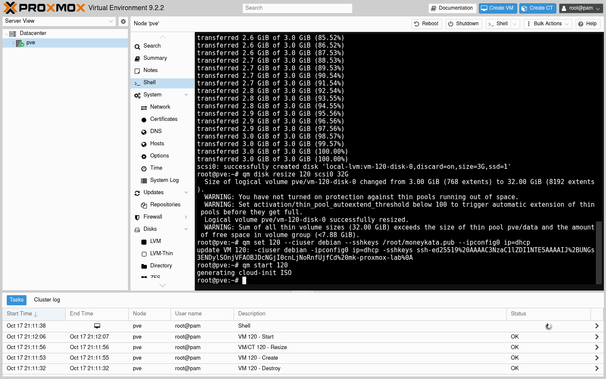
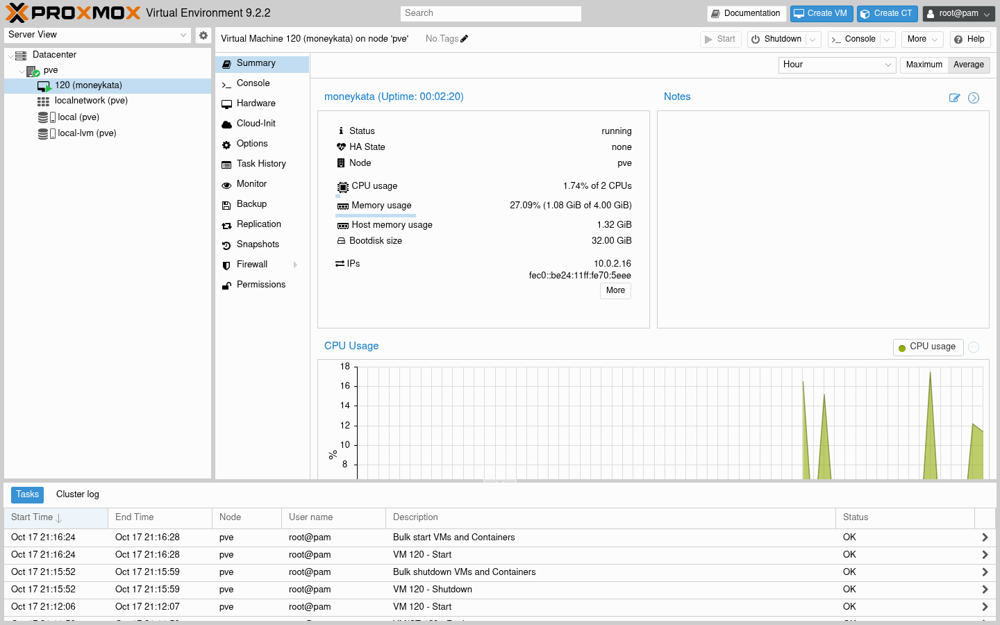
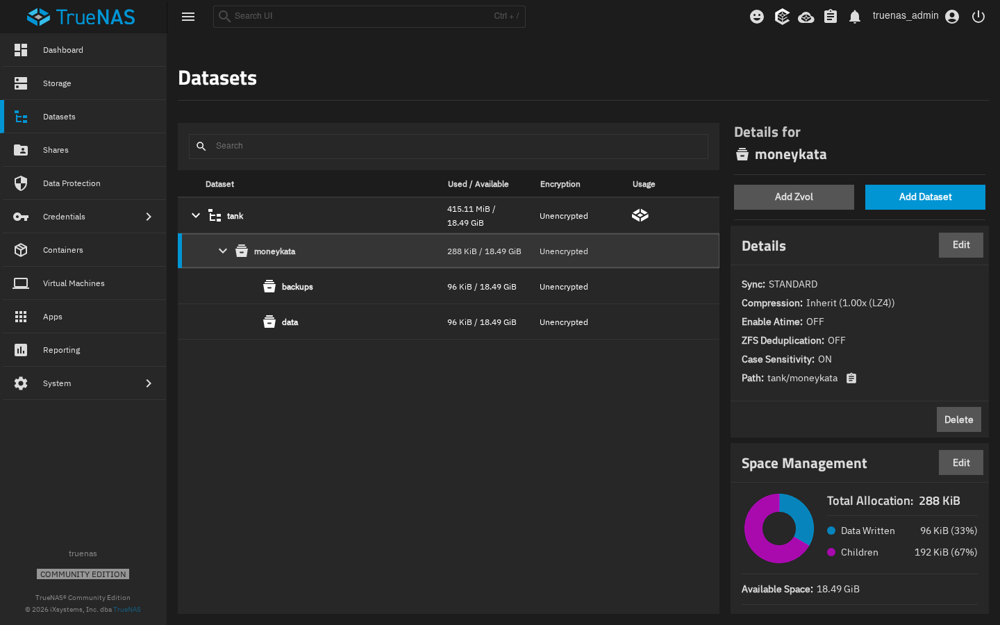
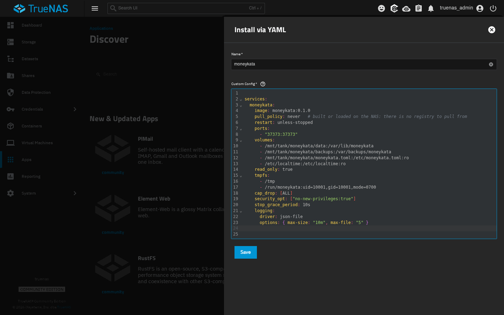
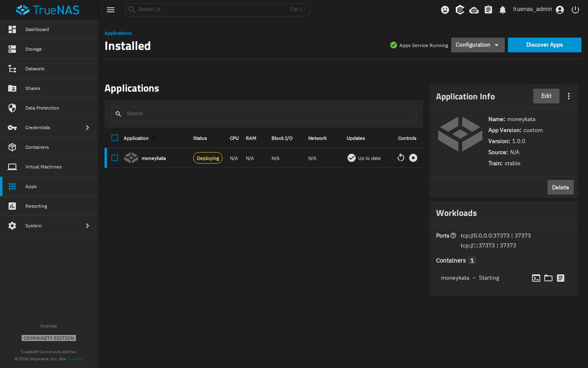
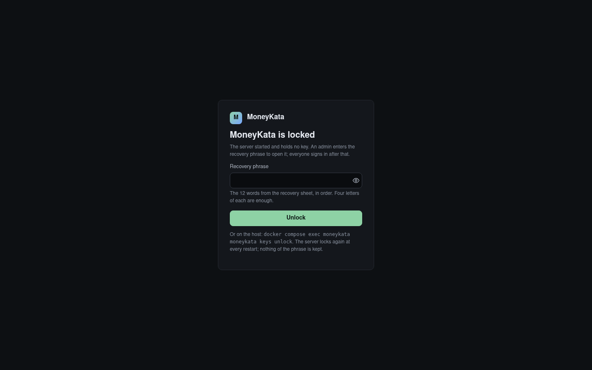
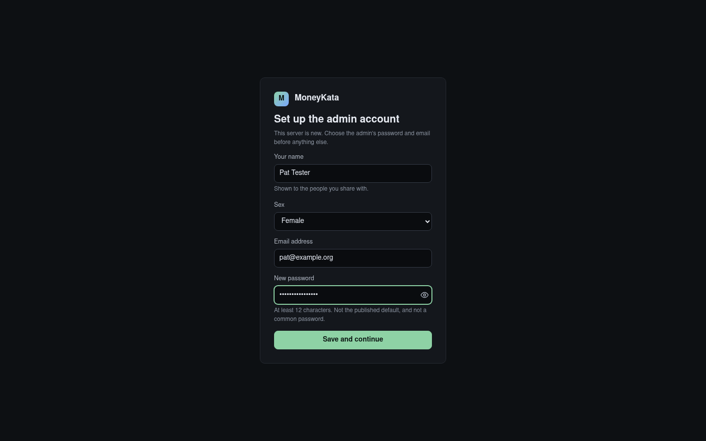
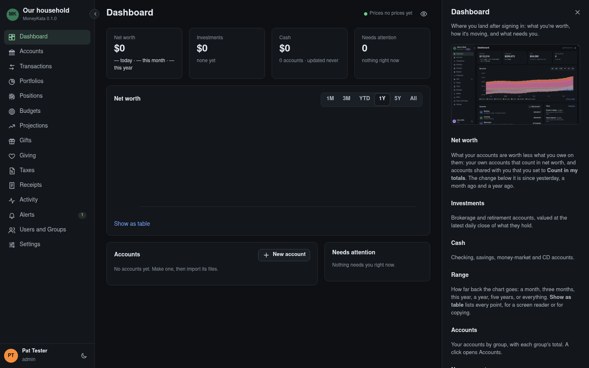

# Deploying MoneyKata

How to build MoneyKata and put a server where people can start testing it, on the first two
hosts it targets: **a fresh VM on Proxmox VE** and **TrueNAS**. Both run the same image, and
both serve HTTPS themselves on port 37373 with a self-signed certificate (`tls` mode,
requirements S13.3), which is what a test on a local network needs. A server the household
relies on goes behind its reverse proxy instead ([`operations.md`](operations.md) §2), and
`operations.md` is the runbook for everything after the install: upgrades, backups, restoring,
keys and the connector.

The steps were run as written on Proxmox VE 9.2 with a Debian 13 guest and Docker Engine 29,
and on TrueNAS Community Edition 25.10.7; the screenshots are from those runs.

## 1. What you need

- **A host**: amd64 (arm64 works too, S17.8.1), with **2 GB of memory** for MoneyKata (1 GB
  with receipt reading turned off, Settings › Receipts) and about **5 GB of disk** for the
  image, the build and the data.
- **Internet access** from wherever the image is built: GitHub (the source), Docker Hub (the
  Python base image) and PyPI (the libraries, each pinned by hash).
- **Paper and a pen.** The server's master key is a **recovery phrase** of 12 words, shown
  once and never stored (S15). It is asked for after every start of the server: a reboot, an
  upgrade, a restart. Without it the data can't be opened, by anyone.
- **A browser** on the same network as the host.

## 2. Building the image

There is no registry (S17.8.2): the image is built from the source, on the host that runs it
or on another machine and carried over.

```sh
git clone https://github.com/MojoKata/MoneyKata.git
cd MoneyKata
docker buildx build -f web/install/Dockerfile -t moneykata:$(cat web/VERSION) --load .
```

`web/VERSION` holds the release (`0.1.0`). The build takes about three minutes on a VM with two
cores, and the image is under 1 GB. To carry it to another host:

```sh
docker save moneykata:0.1.0 | gzip > moneykata-0.1.0.tar.gz   # where it was built
docker load -i moneykata-0.1.0.tar.gz                          # on the host that runs it
```

The **MoneyKata Connector** (S18), which signs in to institutions that have a driver, is a
second image and is not needed to try MoneyKata: accounts are kept current from the files
you upload. [`operations.md`](operations.md) §8 adds it.

## 3. A fresh VM on Proxmox VE

[Proxmox VE](https://www.proxmox.com/en/products/proxmox-virtual-environment/overview) runs
MoneyKata in a Debian VM with Docker. If Proxmox isn't installed yet:
[download](https://www.proxmox.com/en/downloads/proxmox-virtual-environment/iso) the ISO and
follow the [installation guide](https://pve.proxmox.com/wiki/Installation).

### 3.1 Make the VM

The quickest fresh VM is Debian's own cloud image with
[cloud-init](https://pve.proxmox.com/wiki/Cloud-Init_Support): no installer to click through.
In the Proxmox web UI, select the node and open **Shell**, then:

1. **Fetch the image**, Debian 13 from
   [Debian's cloud images](https://cloud.debian.org/images/cloud/):

   ```sh
   cd /root
   wget https://cloud.debian.org/images/cloud/trixie/latest/debian-13-genericcloud-amd64.qcow2
   ```

2. **Put your SSH public key** in a file, for the VM's user: paste it into
   `/root/moneykata.pub` (`nano /root/moneykata.pub`). It is the `.pub` file in `~/.ssh` on
   your own computer; `ssh-keygen -t ed25519` there makes one if you have none.
3. **Make the VM**: 2 cores, 4 GB of memory (the build is quicker with it; 2 GB runs
   MoneyKata), a 32 GB disk made from the image, and a cloud-init drive. `120` is the VM's id
   and `local-lvm` the storage for its disks: use a free id, and your storage if it differs
   (**Datacenter › Storage** lists them; a ZFS install calls it `local-zfs`).

   ```sh
   qm create 120 --name moneykata --cores 2 --memory 4096 --cpu host --ostype l26 \
     --scsihw virtio-scsi-single --net0 virtio,bridge=vmbr0 --agent enabled=1 \
     --scsi0 local-lvm:0,import-from=/root/debian-13-genericcloud-amd64.qcow2,discard=on,ssd=1 \
     --ide2 local-lvm:cloudinit --boot order=scsi0 --serial0 socket --vga serial0 --onboot 1
   qm disk resize 120 scsi0 32G
   qm set 120 --ciuser debian --sshkeys /root/moneykata.pub --ipconfig0 ip=dhcp
   qm start 120
   ```

   For a fixed address, use `--ipconfig0 ip=192.168.1.50/24,gw=192.168.1.1` instead of
   `ip=dhcp`. `--onboot 1` starts the VM when the Proxmox host starts.

   

4. **Find its address**: your router's list of DHCP leases shows it under the name
   `moneykata`, unless you gave it a fixed one. (The VM's **Console** shows only its boot and
   a login prompt, and the user has no password: sign in over SSH.) Once
   `qemu-guest-agent` runs (§3.2), the VM's **Summary** shows the address under **IPs**. The
   rest of this section calls it `192.168.1.50`.

   

### 3.2 Install Docker

Sign in to the VM (`ssh debian@192.168.1.50`) and install Docker Engine from
[Docker's own repository for Debian](https://docs.docker.com/engine/install/debian/):

```sh
sudo apt-get update
sudo apt-get install -y ca-certificates curl git qemu-guest-agent
sudo install -m 0755 -d /etc/apt/keyrings
sudo curl -fsSL https://download.docker.com/linux/debian/gpg -o /etc/apt/keyrings/docker.asc
sudo chmod a+r /etc/apt/keyrings/docker.asc
sudo tee /etc/apt/sources.list.d/docker.sources <<EOF
Types: deb
URIs: https://download.docker.com/linux/debian
Suites: $(. /etc/os-release && echo "$VERSION_CODENAME")
Components: stable
Signed-By: /etc/apt/keyrings/docker.asc
EOF
sudo apt-get update
sudo apt-get install -y docker-ce docker-ce-cli containerd.io docker-buildx-plugin docker-compose-plugin
sudo usermod -aG docker debian
sudo systemctl start qemu-guest-agent
sudo timedatectl set-timezone America/Chicago     # your own: backups and emails follow it
```

Sign out and in again, so `docker` works without `sudo`. `qemu-guest-agent` lets the Proxmox
UI show the VM's address on its **Summary**; it starts by itself at every boot after this one.

### 3.3 Build and set up

1. **Build the image** on the VM, as §2 says, from your home folder, so the source is in
   `~/MoneyKata`.
2. **Make a folder for the server**, from the examples in the source:

   ```sh
   mkdir ~/moneykata && cd ~/moneykata
   cp ~/MoneyKata/web/install/compose.tls.yaml compose.yaml
   mkdir data backups && sudo chown 10001:10001 data backups
   ```

3. **Write its configuration**, `moneykata-tls.toml`, naming the address browsers will use, so
   the self-signed certificate covers it:

   ```sh
   cat > moneykata-tls.toml <<'EOF'
   [server]
   name = "moneykata"
   mode = "tls"
   port = 37373

   [paths]
   data = "/var/lib/moneykata"
   backups = "/var/backups/moneykata"

   [tls]
   names = ["192.168.1.50"]
   EOF
   ```

4. **Make the master key**: `docker compose run --rm moneykata keys init`. It shows the
   **recovery phrase**, 12 words. Write them down, then type the three it asks for. Nothing
   shows the phrase again (S15.6 says how to keep it: two copies in two places, one offline).
5. **Start it**: `docker compose up -d moneykata`. Name the service: the compose file's
   other one is the connector, whose image isn't built (§2), and a bare `docker compose up -d`
   stops at it with *pull access denied for moneykata-connector*.
6. **Unlock it** in a browser, §5.

### 3.4 After a reboot

The VM starts with the host (`--onboot 1`), and Docker starts MoneyKata with it
(`restart: unless-stopped`, S13.6), **locked**: open it and enter the phrase (§5).
`docker compose ps` in `~/moneykata` shows `health: starting` for its first two minutes or
so, then `unhealthy` while it waits for the phrase, and `healthy` once it has it.

## 4. TrueNAS

[TrueNAS Community Edition](https://www.truenas.com/truenas-community-edition/) 25.10
("Goldeye") runs apps as Docker Compose projects, and MoneyKata installs as a **custom app**
from YAML. If TrueNAS isn't installed yet: [download](https://www.truenas.com/download/) the
ISO and follow the
[installation guide](https://www.truenas.com/docs/scale/25.10/gettingstarted/install/).
The steps below use a pool named `tank` and the NAS's address `192.168.1.20`.

### 4.1 Pool, apps and datasets

1. **A pool**: **Storage › Create Pool**, if there isn't one.
2. **Apps**: open **Apps**. Until it has a pool it says *Apps Service Not Configured*:
   **Configuration › Choose Pool**, pick `tank`, **Choose**.
3. **Datasets**: **Datasets**, select `tank`, **Add Dataset**: name it `moneykata`, preset
   **Generic**, **Save**. Select `tank/moneykata` and add two datasets inside it the same
   way: `data` and `backups`. Separate datasets let snapshots and replication treat them
   apart (operations.md §2.3).



### 4.2 The image, the configuration and the key

Open **System › Shell**; `sudo` asks for `truenas_admin`'s password. Keep the page open
until each command has finished. (SSH works as well, once it is turned on under **System ›
Services**; it is off by default.)

1. **Build the image** straight from GitHub (about two minutes; TrueNAS has git and Docker's
   BuildKit), or load one built elsewhere (§2) with `sudo docker load -i moneykata-0.1.0.tar.gz`:

   ```sh
   sudo docker build -t moneykata:0.1.0 -f web/install/Dockerfile https://github.com/MojoKata/MoneyKata.git#main
   ```

2. **Give the datasets to the container's user** (uid 10001) and **write the configuration**
   beside them:

   ```sh
   sudo chown 10001:10001 /mnt/tank/moneykata/data /mnt/tank/moneykata/backups
   sudo tee /mnt/tank/moneykata/moneykata.toml >/dev/null <<'EOF'
   [server]
   name = "moneykata"
   mode = "tls"
   port = 37373

   [paths]
   data = "/var/lib/moneykata"
   backups = "/var/backups/moneykata"

   [tls]
   names = ["192.168.1.20"]
   EOF
   ```

3. **Make the master key**. It shows the **recovery phrase**, 12 words: write them down, then
   type the three it asks for.

   ```sh
   sudo docker run --rm -it \
     -v /mnt/tank/moneykata/data:/var/lib/moneykata \
     -v /mnt/tank/moneykata/backups:/var/backups/moneykata \
     -v /mnt/tank/moneykata/moneykata.toml:/etc/moneykata.toml:ro \
     moneykata:0.1.0 keys init
   ```

### 4.3 Install the app

**Apps › Discover Apps**, then **⋮** (**More Options**, beside **Custom App**) **› Install
via YAML**. Name it `moneykata`, paste this as **Custom Config**, and **Save**:

```yaml
services:
  moneykata:
    image: moneykata:0.1.0
    pull_policy: never   # built or loaded on the NAS: there is no registry to pull from
    restart: unless-stopped
    ports:
      - "37373:37373"
    volumes:
      - /mnt/tank/moneykata/data:/var/lib/moneykata
      - /mnt/tank/moneykata/backups:/var/backups/moneykata
      - /mnt/tank/moneykata/moneykata.toml:/etc/moneykata.toml:ro
      - /etc/localtime:/etc/localtime:ro
    read_only: true
    tmpfs:
      - /tmp
      - /run/moneykata:uid=10001,gid=10001,mode=0700
    cap_drop: [ALL]
    security_opt: ["no-new-privileges:true"]
    stop_grace_period: 10s
    logging:
      driver: json-file
      options: { max-size: "10m", max-file: "5" }
```



The install finishes at once. The app shows **Deploying** while MoneyKata waits for the
phrase, and **Running** once it is unlocked (§5). The NAS's time zone (**System › General
Settings › Localization › Settings**) is the server's, for backups and emails.



### 4.4 Snapshots and restarts

- **Data Protection › Periodic Snapshot Tasks › Add**: **Dataset** `tank/moneykata`,
  **Recursive** ticked, **Save**; by default it keeps two weeks of daily snapshots. Nothing
  in them opens without the phrase; operations.md §2.3 says what a snapshot is and isn't.
- After the NAS restarts, the app starts again by itself (`restart: unless-stopped`),
  **locked**, and shows **Deploying** until someone enters the phrase (§5).
- Deleting the app (the app's **Delete**) offers **Remove Images**, ticked: untick it, or the
  image goes too and has to be built again before the app installs. The datasets stay as
  they are either way.

## 5. Unlocking and the first sign-in

1. Open `https://<address>:37373` (`https://192.168.1.50:37373` for the VM,
   `https://192.168.1.20:37373` for the NAS). The browser warns that the certificate isn't
   trusted, since MoneyKata made it itself: continue to the site.
2. The **locked** screen asks for the recovery phrase. Enter the 12 words; the server opens
   its database and the sign-in page follows.

   

3. Sign in as **`admin`** with the published password **`moneykata-setup`**. The first sign-in
   leads only to **Set up the admin account** (S10.1.2): a name, sex, an email address and a
   new password of at least 12 characters.

   

4. Then the **Dashboard**. **Users and Groups** invites the other testers. An invitation is
   an email: until **Settings › Email** has an SMTP server, each is written to the mail folder
   instead, and **Settings › Email** lists them, with **Open** to show the link to pass on.
   The help pane (**F1**) explains every screen, and `/demo` on the same address is the
   clickable mockup with sample data.

   

Instead of the browser, the phrase can be entered on the host:
`docker compose exec moneykata moneykata keys unlock` in `~/moneykata` on the VM;
`sudo docker exec -it ix-moneykata-moneykata-1 moneykata keys unlock` on TrueNAS.

## 6. A new build

1. Pull the source and build the new image (§2), with the new version's tag.
2. Change the tag in the compose file and start it again: `docker compose up -d moneykata`.
   On TrueNAS, **Edit** under **Application Info** opens **Edit App YAML**; **Save** there
   makes the container again.
3. Unlock it (§5). At the unlock the server copies the database aside and migrates it;
   operations.md §3 says how to go back.

## 7. When something's wrong

- **It won't start**: `docker compose ps` shows it `Restarting`, since it tries again about
  once a minute. `docker compose logs moneykata` shows why, in a line beginning `refusing to
  start:`; operations.md §5.1 lists the usual causes. On TrueNAS, the app's page lists its
  container under **Workloads**, and its **View Logs** icon shows the log.
- **The page won't load**: it is `https://`, on port 37373. A browser that refuses the
  certificate outright was given an address the certificate doesn't name: add it under
  `[tls] names` and restart; the server makes a new certificate.
- **It says it's locked**: it waits for the phrase after every start (§5).
- **A lost phrase**: a running, unlocked server can still make a new one,
  `keys rotate` (operations.md §7). Once it restarts without one, nothing opens the data.
