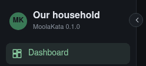
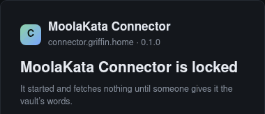

# Making a release

How a new version of MoolaKata reaches testers and households. A release is a `v<version>` tag
on `main` and a GitHub release that names it. The tag starts `.github/workflows/release.yml`
(requirements S17.10.2). It builds both images on an amd64 and an arm64 runner and runs
`web/install/smoke.sh` on each, which is the release gate (S17.8.1). It then pushes the images
to `ghcr.io/mojokata`, joins each image's two architectures under the version's tag, and
attests both images (S17.8.2). Everything before the tag happens in an ordinary pull request.
Everything after it is checking what was published.

The steps were written from 0.1.0's release. Every release from then on has a tag its
maintainer signs (§5).

## 1. Before you start

- **Write access to `MojoKata/MoolaKata`.** The release and its tag are made there; a fork
  can open the release's pull request but not tag it.
- **A GPG key on your GitHub account** (**Settings › SSH and GPG keys**), to sign the tag
  (§5).
- **[`gh`](https://cli.github.com/)**, GitHub's command line. Get it from
  [cli.github.com](https://cli.github.com/) (for Linux, its
  [install page](https://github.com/cli/cli/blob/trunk/docs/install_linux.md) adds GitHub's
  package repository), and sign in once with `gh auth login`. `gh release verify` (§8) needs
  version 2.81 or later.
- **Docker** with buildx, to check what was published (§7).
- **A checkout set up for development** (`web/dev.sh setup`, README), for the regenerated
  files and `web/check`. Its remote for MojoKata/MoolaKata is called `upstream` below. In a
  clone of MojoKata/MoolaKata itself, that remote is `origin`.
- **The release tags' ruleset**, set once. In MojoKata/MoolaKata, go to **Settings › Rules ›
  Rulesets › New ruleset › New tag ruleset**. Set its target to tags matching `v*`, turn on
  **Restrict creations**, **Restrict updates** and **Restrict deletions**, and put the
  maintainers in its bypass list. Only a maintainer can then create a release tag, and only a
  maintainer can move or delete one (§10).
- **Immutable releases**, set once. In MojoKata/MoolaKata, go to **Settings › General ›
  Releases** and turn on **Enable release immutability**. A published release's tag and
  files are then locked, and GitHub signs an attestation of the release (§8). Releases
  published before the setting was turned on, 0.1.0 among them, stay as they were.
- **Docker Hub**, set up once by a maintainer. These are what `release.yml` needs to publish
  there:
  1. **The namespace.** Sign up at [hub.docker.com](https://hub.docker.com/signup) for a free
     account whose Docker ID is `mojokata`. An *organization* on Docker Hub needs a paid Team
     plan. An account can be turned into an organization of the same name later, if one is
     ever needed. Turn on two-factor authentication, and keep the password and recovery
     codes in the maintainers' password manager.
  2. **The two repositories.** Create `mojokata/moolakata` and `mojokata/moolakata-connector`,
     both **Public**. Give each a short description that links to this repository and
     `docs/DEPLOY.md`.
  3. **The workflow's token.** Go to **Account settings › Personal access tokens › Generate
     new token**. Describe it as *MoolaKata releases*, give it **Read & Write** access, never
     Delete, and set an expiry date with a reminder to renew it
     ([Docker's guide](https://docs.docker.com/security/access-tokens/)). It is shown once.
  4. **Where GitHub keeps it.** In MojoKata/MoolaKata, go to **Settings › Environments › New
     environment** and create `docker-hub`. Under **Deployment branches and tags**, choose
     **Selected branches and tags** and add the tag rule `v*`. Add the secret
     `DOCKERHUB_TOKEN` (the token) and the variable `DOCKERHUB_USERNAME` (`mojokata`). Only a
     job that runs for a release tag can read them. Pull requests, a fork's included, never
     can.
  5. **No pull limits.** Apply for the namespace to join
     [Docker-Sponsored Open Source](https://www.docker.com/community/open-source/application).
     Until it is accepted, Docker Hub limits anyone who isn't signed in to 10 pulls an hour
     from one address. ghcr.io has no such limit.
- **Done once, at 0.1.0; don't repeat it.** A new package on ghcr.io starts private. MojoKata's
  **Settings › Packages › Package creation** allows public packages, and both packages,
  `moolakata` and `moolakata-connector`, were made public under each package's **Package
  settings › Change visibility**. Every later version inherits that. A third image would need
  it again.

## 2. Pick the version

MoolaKata uses [semantic versioning](https://semver.org): `MAJOR.MINOR.PATCH` (`1.4.2`),
tagged `v` and the same numbers (`v1.4.2`). `release.yml` refuses a tag that isn't `v`
followed by `web/VERSION`'s text. The tests read `DEPLOY.md`'s image tags as three numbers.

1. **MAJOR**: the upgrade needs something from the people who run or use the server, beyond
   changing the tag and unlocking. Examples are a migration that needs a step by hand or a
   guide, a configuration key to edit, a new mount, re-pairing the connector, and linked
   servers that must upgrade together. The release ships with its guide, and its notes open
   with it (§4).
2. **MINOR**: new features.
3. **PATCH**: fixes.

Any of them can carry a migration that the server runs by itself at the unlock. Once that
migration has run, an older release refuses the database. Going back then means restoring the
copy made before the upgrade (`operations.md` §3), and the notes' **Upgrading** section says
so. This lists the migrations since the last release. Read each one to decide whether any of
them needs something from people:

```sh
git diff --stat v0.1.0..upstream/main -- web/server/src/moolakata/store/alembic/versions/
```

The rule holds from 0.1.0 on, with no exception for 0.x. The first upgrade that needs a guide
is 1.0.0, unless 1.0.0 is released earlier by choice. What marks a release for testers is
being a pre-release on GitHub (§8) and the README's **Release** line, not its number.

A version is never reused. Browsers keep the app's files for a year under `/ui/v/<version>/`,
and testers may already have pulled the images under that tag. A second build under the same
version would be served stale to the first group and silently replaced for the second.

## 3. The release's pull request

1. **Branch from an up-to-date `main`**: `git switch -c release-0.2.0 main` once `main`
   matches MojoKata's.
2. **Change the version everywhere it is written by hand.** These are `web/VERSION` (the
   server's version, which the app, the API's document and the release workflow all read),
   the connector's `connector/pyproject.toml` and `connector/moolakata_connector/__init__.py`,
   the image tags in the four `web/install/compose*.yaml` files, `docs/DEPLOY.md`,
   `docs/operations.md` and the README's **Release** line. From the repository's root:

   ```sh
   old=$(cat web/VERSION) new=0.2.0
   git grep -lF "$old" -- web/VERSION connector/pyproject.toml connector/moolakata_connector/__init__.py \
       web/install docs/DEPLOY.md docs/operations.md README.md |
     xargs sed -i "s/${old//./\\.}/$new/g"
   git diff --stat        # 10 files
   ```

   Then read the diff for two lines that need a person's judgement:
   - `DEPLOY.md`'s second paragraph says which release its steps were run with. Put the old
     version back there until §9 has run them with the new one.
   - The README's **Release** line still says *a pre-release for testers*. Keep that
     unless this release is meant for households to rely on.

   The `0.1.0`s left in the dev seed (`seed_connector.py`, `seed_links.py`), in the tests and
   in the hand-written mockup are sample data, and stay as they are.
3. **Move the base image** (S17.8.5). Both Dockerfiles pin `python:3.14-slim-bookworm` by
   digest, and the digest moves with each release:

   ```sh
   web/dev.sh base-update --packages
   ```

   It writes the new digest into both Dockerfiles and records the move in `web/audit.json`.
   It also prints the Debian packages that changed, for the commit message and the release
   notes. Bring the base image's row in `docs/dependencies.md` up to date by hand: the date
   it last moved and what the move picked up.
4. **Regenerate what carries the version**: the API's OpenAPI document (S13.8.9), in a few
   seconds, and the generated mockup, in about ten minutes:

   ```sh
   (cd web/server && uv run --frozen python -m moolakata.contract write)   # web/ui/api/openapi.json
   web/dev.sh mockup                                                        # docs/mockups/MoolaKata-app.html
   ```

   The mockup's diff is the version alone, in its `mk-version` meta tag and the recorded
   `/ui/api/session` and `/ui/api/unlock` answers. Anything more means `main` had drifted
   already. Find out why before going on.
5. **Bring every document that goes with the release up to date**, in this same pull
   request. Its documents describe the release from the moment it is tagged. Start from
   what changed since the last release, `git log --oneline v0.1.0..upstream/main`, and
   check each document against it:
   1. **README**: the **Release** line and the **Status** paragraph.
   2. **`docs/DEPLOY.md`**: every step the release changed (a setting, a screen, a port, a
      file), and new screenshots of the screens that now look different. Its second
      paragraph waits for §9.
   3. **`docs/operations.md`**: the runbook for anything the release changed, such as
      upgrading, commands, configuration keys and backups.
   4. **`docs/test-plan.md`**: a test for anything new that the build can't try by itself.
   5. **The app's guides** (`web/ui/guides/`), which ship inside the image. Each screen the
      release changed must still read true. Retake the screenshots of those screens with
      `web/dev.sh help-shots <key> …`.
   6. **`docs/api.md`, `docs/connector-protocol.md` and `docs/link-protocol.md`**: every
      change to the API, the connector's protocol or the link protocol since the last
      release. The release notes say what each change means for a server and a connector,
      or for two linked servers, that are at different releases (§4).
   7. **`docs/dependencies.md`**: the base image's row (step 3), and any library whose
      **Revisit** has come due.
   8. **`docs/requirements/`**: they carry no versions, so nothing changes for the release
      itself. Check that the README's tables of gaps and open questions match what this
      release leaves open.
6. **Run every check**: `web/check`, which takes about 20 minutes, and look for its last line,
   `all checks passed`. A compose file or a `DEPLOY.md` tag left at the old version fails
   `test_install.py`.
   The generated mockup's crawl sometimes fails without a diff: a Playwright route-handler
   error, or a screen that *drew nothing in 20 s*. When that is the only failure, run it
   again alone, `(cd web/server && uv run --frozen python ../ui/mockup/build.py --check)`.
7. **Commit and open the pull request** against `MojoKata/MoolaKata`'s `main`, titled
   `Release 0.2.0`. Because it touches `web/install/`, two workflows run on it: `check`
   (`web/check`, about half an hour) and `release`, which builds both images and smoke-runs
   them on both architectures without pushing anything. A green pull request means the tag
   will build.
8. **Squash-merge it.** Nothing else should merge between this and the tag. If something
   does, the tag goes on the release's commit rather than on `main`'s head (§5).

## 4. The release notes

The notes tell a tester what changed, how to upgrade, and what was tried by hand. Write them
before tagging, so the release page is complete the moment it appears. A starting point:

```markdown
For testers. A new install follows docs/DEPLOY.md; a server you already run upgrades with
DEPLOY.md §6, then unlocks.

## Before you upgrade
(A major release only: what the upgrade needs from you, step by step.)

## What's new
- (one line for each pull request merged since v0.1.0)

## Upgrading
(A release with a migration:) At its first unlock the server copies its database to
data/pre-upgrade/ and migrates it by itself; an older release can't open it after that, so
going back means restoring that copy (docs/operations.md §3). (A release without one:) Going
back is setting the old tag again. The connector takes the same version.

## Compatibility
(What a server at this release and a connector or linked server at the last one do
together, or that both must be upgraded.)

## Tried by hand (docs/test-plan.md)
Run: T10 on Proxmox VE 9.2 with a Debian 13 guest; T11 on TrueNAS 25.10.7 (by whom).
Not run: T1–T9, T12, T13.

## Images
ghcr.io/mojokata/moolakata:0.2.0 and ghcr.io/mojokata/moolakata-connector:0.2.0, for amd64
and arm64, each with a build-provenance attestation:
gh attestation verify oci://ghcr.io/mojokata/moolakata:0.2.0 -R MojoKata/MoolaKata \
  --signer-workflow MojoKata/MoolaKata/.github/workflows/release.yml \
  --source-ref refs/tags/v0.2.0 --deny-self-hosted-runners
```

- **Before you upgrade**: a major release's guide (§2), placed first so that nobody
  upgrades without reading it. Leave the section out of any other release.
- **What's new**: list the pull requests since the last tag with
  `git log --format='- %s' v0.1.0..upstream/main`. Each squash commit's subject ends in its
  number, and GitHub links `(#9)` to the pull request. GitHub's own list, with authors,
  comes from `gh api repos/MojoKata/MoolaKata/releases/generate-notes -f tag_name=v0.2.0
  -f previous_tag_name=v0.1.0 --jq .body`. Add the base image's move from §3 step 3, naming
  the Debian packages it picked up.
- **Compatibility**: comes from the protocol changes found in §3 step 5.
- **Tried by hand**: the manual test plan requires every release to say which of T1–T13
  were run, by whom and on what, and which were not (S17.9.7.8). That includes T7, the arm64
  image on household hardware, which no runner replaces.
- Link to the documents at the tag (`https://github.com/MojoKata/MoolaKata/blob/v0.2.0/docs/DEPLOY.md`),
  so a later change on `main` doesn't move the instructions under an old release.

## 5. Tag the release

The tag and the release are made separately, about five minutes apart:

1. The maintainer signs the tag by hand with their own GPG key and pushes it (this section).
2. The push starts `release.yml`. It builds both images, smoke-runs them, publishes them to
   ghcr.io, and joins and attests each one. It then drafts the GitHub release, with the
   tag's install files attached (§6).
3. The maintainer checks the published images (§7).
4. Only then does the maintainer publish the draft with its notes, using `gh release edit`
   (§8).

Until that last step there is only a draft, which only people with write access can see.
Testers see nothing, never a release page without its images. A failed build can be fixed
and tagged again under the same version (§10). Once published, the release is immutable
(§1). Its tag and files are locked for good, and only its title and notes can still change.
GitHub's **Draft a new release** form isn't used at any point, because a tag it makes
carries no signature.

1. **Find the release's commit**:

   ```sh
   git fetch upstream
   git log --oneline -1 upstream/main       # Release 0.2.0 (#NN)
   ```

   If something merged after the release's pull request, tag that pull request's commit
   instead of `upstream/main`.
2. **Sign the tag**, and check its signature:

   ```sh
   git tag -s v0.2.0 -m "MoolaKata 0.2.0" upstream/main
   git tag -v v0.2.0                        # gpg: Good signature from …
   ```

   GitHub shows the tag as **Verified** when two things hold. The key must be on your GitHub
   account. The tagger's email (`git config user.email`) must be one of the key's addresses,
   verified on that account.
3. **Push the tag.** The push starts `release.yml` (§6):

   ```sh
   git push upstream v0.2.0
   ```

## 6. Watch the workflow

**Actions › release** shows the tag's run, or from a terminal:

```sh
gh run watch -R MojoKata/MoolaKata "$(gh run list -R MojoKata/MoolaKata --workflow release.yml \
  --branch v0.2.0 --limit 1 --json databaseId --jq '.[0].databaseId')"
```

Four jobs. The first three took about two minutes in all at 0.1.0:

1. **build and smoke (amd64)** and **build and smoke (arm64)**, side by side, on runners
   of their own architecture. Each first checks that the tag names `web/VERSION`, then runs
   `smoke.sh`, then pushes its images as `0.2.0-amd64` or `0.2.0-arm64`.
2. **one tag per image, attested**, once both have passed. It joins each image's two
   architectures under `0.2.0` and attests each joined image.
3. **the release drafted, with the tag's install files**. It drafts the release *MoolaKata
   0.2.0* and attaches, from the tagged commit:
   1. the four `compose*.yaml` files;
   2. the example `moolakata.toml`;
   3. the proxy examples (`Caddyfile`, `nginx.conf`, `haproxy.cfg`).

   This is the only job whose token can write to the repository. The ruleset (§1) still
   keeps it from creating or moving a release tag. The draft shows under **Releases** to
   people with write access, or with `gh release list -R MojoKata/MoolaKata`.

A failure says which step failed in the run's annotations (the job's page, or
`gh api repos/MojoKata/MoolaKata/check-runs/<job id>/annotations`). §10 says what to do next.

## 7. Check what was published

```sh
docker buildx imagetools inspect ghcr.io/mojokata/moolakata:0.2.0              # linux/amd64 and linux/arm64
docker buildx imagetools inspect ghcr.io/mojokata/moolakata-connector:0.2.0
for image in moolakata moolakata-connector; do
  gh attestation verify oci://ghcr.io/mojokata/$image:0.2.0 -R MojoKata/MoolaKata \
    --signer-workflow MojoKata/MoolaKata/.github/workflows/release.yml \
    --source-ref refs/tags/v0.2.0 --deny-self-hosted-runners
done
docker logout ghcr.io && docker pull ghcr.io/mojokata/moolakata:0.2.0          # pulls without signing in
```

1. Each `inspect` lists both platforms under one index.
2. Each `verify` passes only for an image that this repository's `release.yml` built from the
   tag `v0.2.0`, on GitHub's own runners. The image's attestation was signed through Sigstore
   by the workflow's own identity, so no key is kept anywhere. Docker's own signing, Content
   Trust, isn't used: it is being retired.
3. The anonymous pull proves the packages are still public.

## 8. Publish the release

Once §7's checks pass, publish the draft that §6 made, with the notes from §4 saved as
`notes-0.2.0.md`. Then check what GitHub attested:

```sh
gh release edit v0.2.0 -R MojoKata/MoolaKata --draft=false --prerelease \
  --notes-file notes-0.2.0.md
gh release verify v0.2.0 -R MojoKata/MoolaKata                   # the release attestation GitHub signed
gh release download v0.2.0 -R MojoKata/MoolaKata -p compose.yaml -D /tmp/v0.2.0
gh release verify-asset v0.2.0 /tmp/v0.2.0/compose.yaml -R MojoKata/MoolaKata   # one of its files
```

Keep `--prerelease` while releases are for testers (0.1.0 was one), and leave it out for a
release meant for households. Before publishing, check that the draft's **Assets** list all
eight install files.

Publishing makes the release immutable. From then on its tag can't be moved or deleted,
nothing can be attached to it or removed from it, and deleting the release would retire its
version for good. Its title and notes can still be edited, with `gh release edit` or the
release page's **Edit**.

## 9. Run DEPLOY.md with the release

The release isn't finished until its documented install has been run with the published
images:

1. **Upgrade a test server** on each host as `DEPLOY.md` §6 says, and **install one fresh**
   where the steps changed. Once it is unlocked, the app's sidebar shows the new version
   under the household's name, and the connector's page shows it beside its name:

   

   

2. **Record the run** in a small pull request. `DEPLOY.md`'s second paragraph names this
   release and the versions of the hosts it was run on. Every other document already went
   with the release (§3 step 5), so the only other changes are fixes the run found. For
   0.1.0 this was the pull request *0.1.0 is published: DEPLOY.md run with the release
   itself*.
3. **Add the runs to the release's notes** (T10, T11 and any other test from the plan):
   `gh release edit v0.2.0 -R MojoKata/MoolaKata --notes-file notes-0.2.0.md`.

## 10. When something goes wrong

Before §8 there is only a draft, so a version can still be tagged again. The next run's
draft replaces any draft an earlier run made. A wrong tag is deleted by a maintainer, because
the ruleset (§1) lets only them:

```sh
git push upstream :refs/tags/v0.2.0      # GitHub's tag
git tag -d v0.2.0                        # your own copy
```

- **The tag doesn't name the version** (*the tag names this version* fails): nothing was
  pushed. Delete the tag and repeat §5 on the right commit.
- **A build or smoke run fails.** No `0.2.0` exists on ghcr.io yet, at most the other
  architecture's `0.2.0-<arch>`. If the cause is outside the code (a runner, the network),
  use **Re-run failed jobs** on the run. If the code is at fault, delete the tag, fix the
  code in a pull request, and tag the same version again (§5). The next run overwrites the
  per-architecture tags.
- **The joining or attesting job fails**: **Re-run failed jobs**. It reads only the
  per-architecture images the builds pushed, so it can run again on its own.
- **The drafting job fails**: **Re-run failed jobs**. It deletes any draft for the tag before
  making its own, so a rerun never leaves two.
- **§7 finds something wrong with the joined images**: `0.2.0` is on ghcr.io, and anyone may
  have pulled it. Don't publish its release and don't move its image. Fix forward with a new
  patch (`0.2.1`), whose notes say that 0.2.0 was skipped and why.
- **Something is wrong after the release is published**: the release is immutable. Fix
  forward with a new patch (`0.2.1`), and say in `0.2.0`'s notes what is wrong with it.
