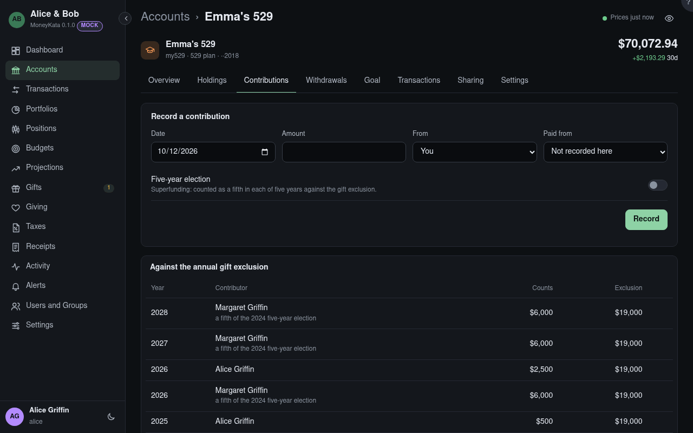

# Account: Contributions

Deposits into a 529 and who made them, totalled per contributor per year against the annual gift
exclusion.

## Record a contribution

A deposit, with who it came from and, when it was paid from one of your bank accounts, that half of
the transfer too.

## Date

The day it was deposited.

## Amount

What was put in.

## From {#contributor}

You, or one of the household's people: a grandparent's contribution is their gift to the beneficiary.

## Paid from {#from-account}

The bank account it came from, to record both halves of the transfer. _Not recorded here_ leaves the
bank side alone, for a deposit already imported there.

## Five-year election

Superfunding: up to five years of exclusions given at once. It counts a fifth against the exclusion
in its year and each of the next four, and needs a gift-tax return (Form 709) to elect it.

## Against the annual gift exclusion

What each contributor's gifts to the beneficiary come to each year, against that year's exclusion
from the tax tables. Above it, a gift-tax return (Form 709) is needed, even when no tax is due.

## Contributions

Every deposit. An imported deposit counts as yours until you say who it was from.

## From

Who a deposit came from; change it for an imported one.

## State tax deduction

What you expect to deduct on your state return, typed in the plan's settings. State rules aren't
modelled.

## Rollover to a Roth IRA

After 15 years, up to a lifetime limit can roll over to the beneficiary's Roth IRA. Contributions of
the last five years, and their earnings, can't; each year's rollover is held to that year's IRA
limit.
