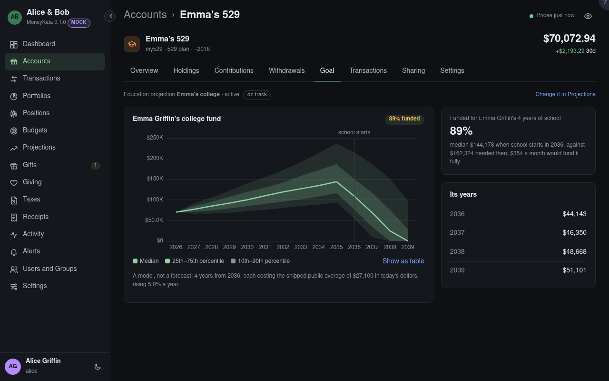

# Account: Goal

The beneficiary's education projection: what the 529 may hold when school starts, against what the
years of school will cost.

## Funded

The median balance when school starts against what its years will cost then, as a percentage, and
the monthly saving that would fund it fully.

## The chart

The balance by year, from the 10th to the 90th percentile of many runs, falling as each year of
school is paid.

## Its years

What each year of school is projected to cost, rising with education inflation.

Change its figures, make it active, or share it on the Projections screen.
