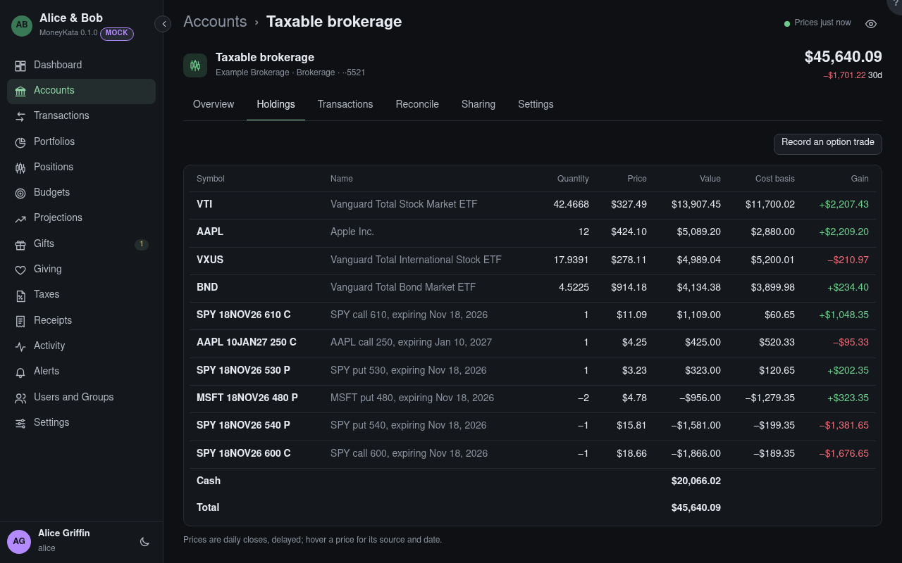

# Account: Holdings

What the account holds, worked out from its trades and lots.

## Price

The latest daily close. Hover it for its source and date: a close from a price source, the broker's
statement value, a price the account's owner typed, or their last trade when nothing else is known.

## Cost basis

What you paid for what you still hold, fees included. A sale's gain or loss is its proceeds less the
cost basis of the lots it sold.

## Lots

A click on a holding lists its lots: each purchase, with its date, quantity and basis. A lot held
more than a year is **long term**, which taxes treat differently.

## Basis missing

A lot whose cost isn't known yet, such as shares transferred in. Add it from the transaction.

## Stand-in

A lot made from the broker's position, where the imported history doesn't explain what's held. Its
basis is missing until you add the earlier history or the basis.
