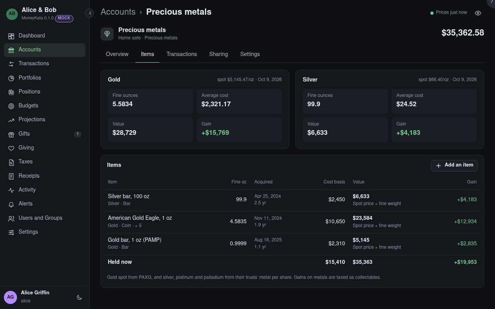

# Account: Items

What a physical-asset account holds, each item with its cost basis, value and gain. The account is
worth what its items are.

## By metal

Precious metals summed by metal: fine troy ounces held, the average cost of an ounce, the value at
spot and the gain. Sold items leave it.

## Items

Each item with the day it was acquired and how long it's been held, its cost basis, its value and
what that rests on (a valuation's source and date, spot, or depreciation), and the gain. A valuation
over a year old is marked. Click an item to see or change it, add valuations and documents, or
record its sale.

## Held now

The totals of what is still held.
