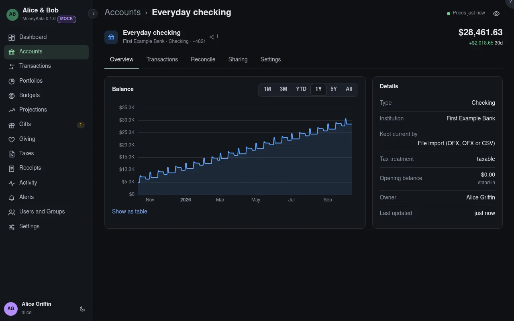

# Account: Overview

One account's balance over time and its details.

## Range

How far back the chart goes. **Show as table** lists every point.

## Details

The account's type, institution, how it's kept current and its tax treatment.

## Opening balance

The balance before the first transaction. When none was typed, it's worked out from the earliest
balance the institution reported, and marked **stand-in**: it stands in for history that wasn't
imported.

{{account-type overview}}
