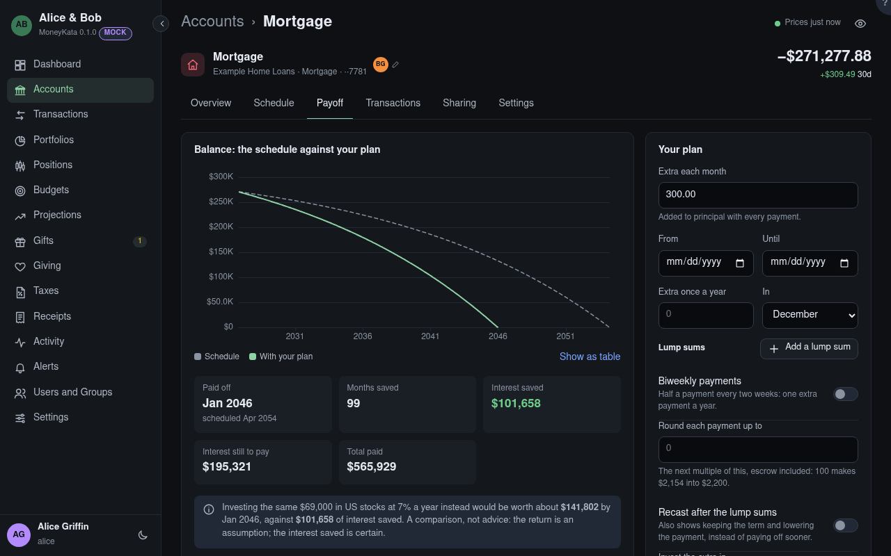

# Account: Payoff

The payoff planner: what overpaying would do, against the schedule. It's worked out as you type,
from the loan's terms and the payments made so far.

## The chart

The balance owed on the schedule (dashed), with your plan, and recast after the lump sums when you
ask for it.

## Paid off

The payoff date with the plan, against the scheduled one. **Months saved**, **interest saved** and
**interest still to pay** follow from it; **total paid** counts everything paid from now on, escrow
and fees included.

## Shorten or recast

After a lump sum the servicer can **recast** the loan: the balance is re-amortized over the rest of
the term, so the payment drops and the payoff date stays. Shortening keeps the payment and ends the
loan sooner, and saves more interest. The recast fee is taken off its interest saved.

## Investing instead

The same money invested on the days it would have been paid, at your expected return for the asset
class you choose, and its value at the plan's payoff date. A comparison, not advice: the return is
an assumption, the interest saved is certain.

## Extra each month

Added to principal with every payment.

## From {#monthly-from}

The first payment it goes with. Blank: the next one.

## Until {#monthly-until}

The last payment it goes with. Blank: until the loan is paid.

## Extra once a year

A bonus payment once a year, with the payment due in the month you choose.

## In {#yearly-month}

The month of the yearly extra.

## Lump sums

One-time payments toward principal, each with the first payment due on or after its date.

## Biweekly payments

Half a payment every two weeks makes 26 half-payments, one extra payment a year: here, a twelfth of
the payment more each month.

## Round each payment up to {#round-to}

Each payment, escrow included, rounded up to the next multiple of this; the difference goes to
principal.

## Recast after the lump sums

Also works out the loan recast after each lump sum, beside it shortened.

## Recast fee

What the servicer charges for each recast, often $250 to $500.

## Invest the extra in {#invest-class}

The asset class for the comparison; its expected return is yours, from Profile › Assumptions.

## Saved plans

Plans kept for this loan. **Show** puts one back in the form. **Follow** makes it the plan you're
following: from that day, the loan's Overview shows whether what you've overpaid is ahead of it or
behind.

## Plan name

What the plan is called in the list.
