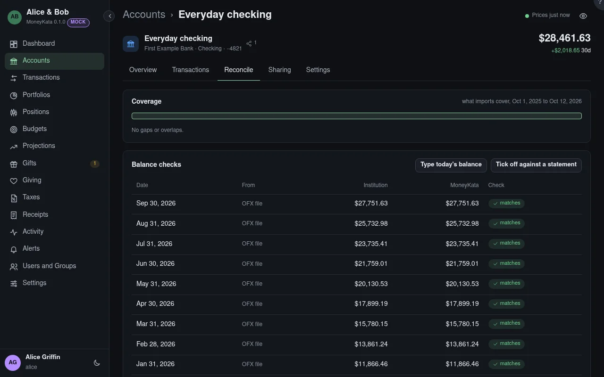

# Account: Reconcile

Keeps the account's balance in step with the institution's. For files you import, it is a set of
quiet checks; ticking off is there when you want it.

## Coverage

The periods your imports cover. A **gap** is a stretch nothing was imported for; an **overlap** is
two imports covering the same days, whose shared rows were matched, not doubled.

## Type today's balance

Copy the balance from the institution's site. MoneyKata compares it with its own for that day.

## Tick off against a statement

Enter a statement's closing date and balance, then tick transactions as cleared until the difference
is zero. The period is then reconciled, and editing a transaction inside it asks first.

## Balance checks

Every balance the institution reported (an OFX file's balance, a CSV's balance column, a statement,
or a typed one), next to MoneyKata's for the same day.

## Mismatch

When they differ, the window between the last matching balance and this one is searched for what's
suspect: identical rows on one day, amounts that changed between imports, gaps, and the first row
where a CSV's running balance parts from MoneyKata's.

## Possible duplicate

Two identical rows on one day. **Both are real** keeps both and remembers it; otherwise delete one
from Transactions.

## Accept as an adjustment

Records the difference as a balance adjustment with a note, shown as such in the account and in
Activity.

## Statement values {#value-checks}

A brokerage statement's ending value against what MoneyKata says the account was worth that day:
cash and holdings at that day's prices. Within half a percent counts as a match.

## Holdings check {#holdings-check}

The latest brokerage statement's positions against what MoneyKata holds on its last day. A
quantity that differs is shown with the difference: a missed split, a reinvestment or a buy not
entered yet.
