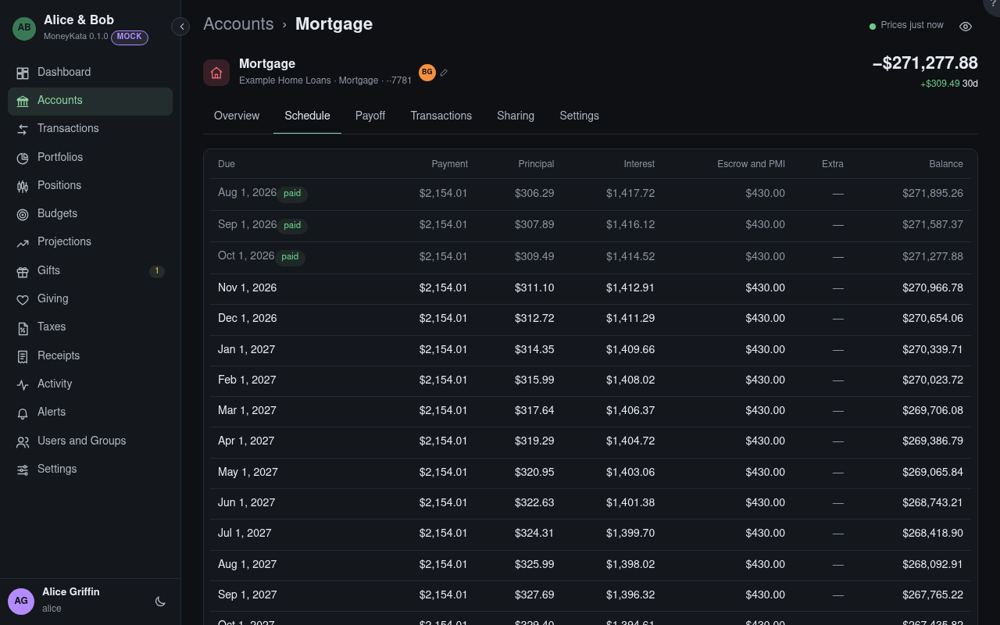

# Account: Schedule

A loan's amortization schedule, computed from its terms and the payments made.

## Due

Each payment's due date. Payments already made are marked **paid**, with what was actually paid and
how it split.

## Payment

Principal, interest, escrow and PMI together.

## Extra

Principal paid beyond the schedule: an overpayment, which brings the payoff date nearer and lowers
the interest still to pay.

## Balance

The principal owed after the payment.

## Show all

The table shows the last few payments and the next year. **Show all** lists every one to the payoff.

A payment that differs from the schedule, a rate reset or a recast recomputes the rest.
