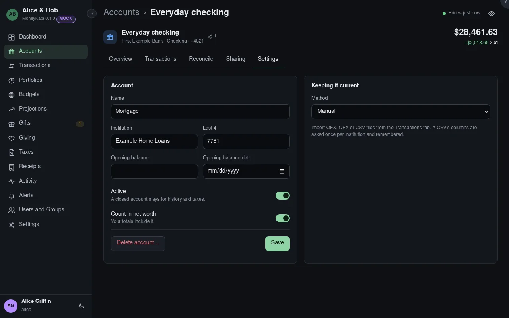

# Account: Settings

The account's name, how it's kept current, and its lot method.

## Name

What the account is called in your lists.

## Institution

The bank, broker or plan administrator: a label, not a connection.

## Last 4 {#mask}

The last four digits of the account number, to tell accounts apart.

## Lot method

Which lots a sale takes: **FIFO** the oldest first (the default), **LIFO** the newest, **HIFO** the
most expensive, **specific identification** the ones you pick, or **average cost**. The method in
force at a sale is recorded with it.

## Opening balance

A balance before the first transaction, with its date. Leave it empty to work it out from the
earliest balance the institution reported.

## Opening balance date {#opening-date}

The day the opening balance applies to.

## Active

A closed account stays, for history and taxes, but is marked closed.

## Count in net worth

Whether your totals include it.

## Delete account

Deletes it with its transactions, only by its owner. The click asks again first.

## Count in my totals

On an account shared with you: whether your net worth includes it. Off by default, so a spouse's
accounts count once.

## Method {#kept-by}

How the account is kept current: from files you import (OFX, QFX or CSV), or by hand.

{{account-type settings}}
