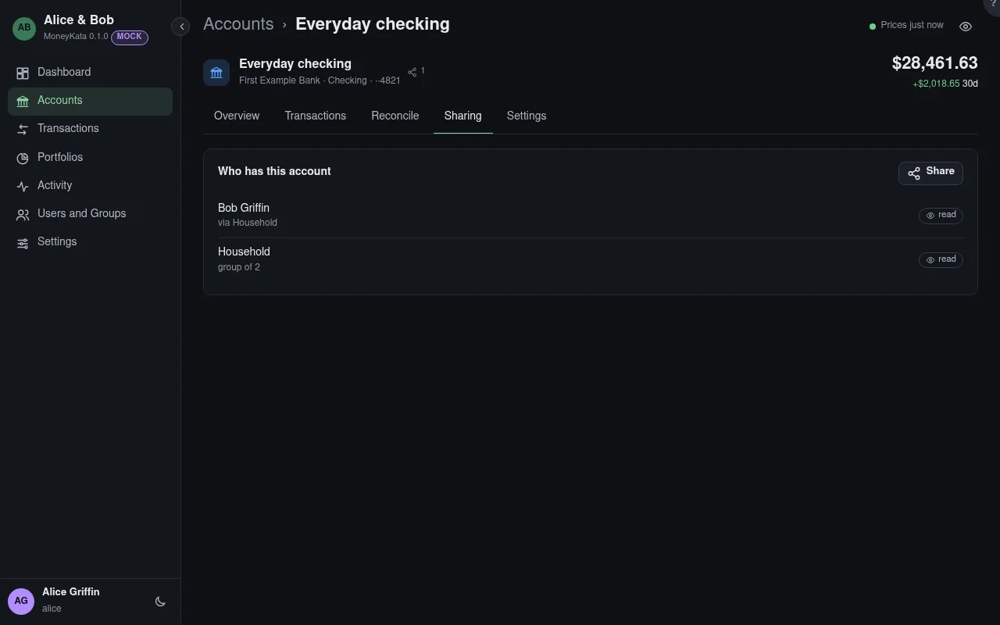

# Account: Sharing

Who else has this account.

## Who has this account

Each person or group, directly or through a group, with their level.

## Share

Opens the Share dialog. A new account is shared with no one.

## Read and write

**Read** sees everything about the account and changes nothing. **Write** also changes what it
holds: transactions, imports and categories. Nobody but the owner deletes it, changes its settings
or shares it.
