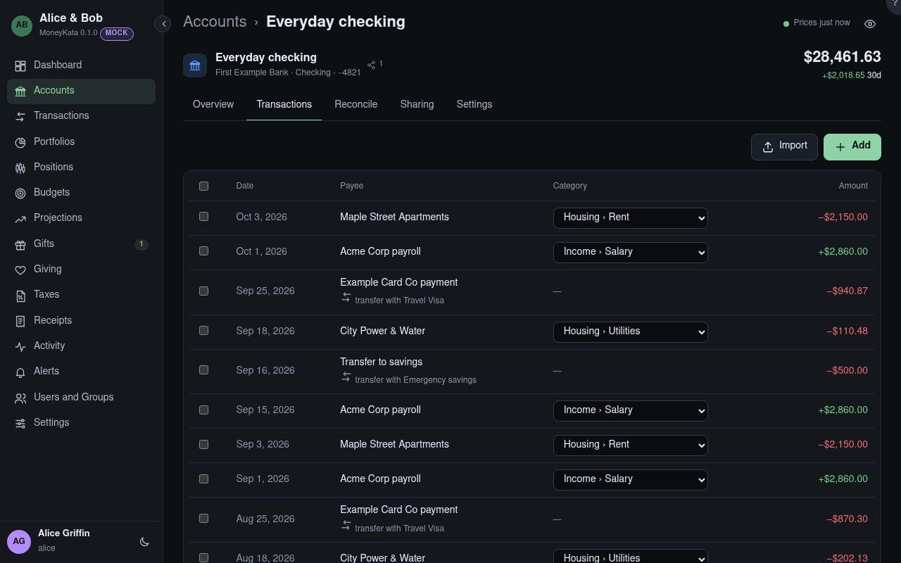

# Account: Transactions

This account's transactions, newest first.

## Import

Adds a file's transactions to this account. Rows already here are matched, not doubled.

## Add

Types a transaction by hand.

## Categorise as

Select rows with their boxes, choose a category, and **Categorise** them together.

## Category

Change one transaction's category in place. A split shows its parts in the transaction itself.

## Transfers

Money moving between two of your accounts is matched (the same amount the other way, within a few
days), and counts as neither spending nor income.

## Page size

How many rows a page shows: 100, 500 or 1,000. The browser remembers it.
