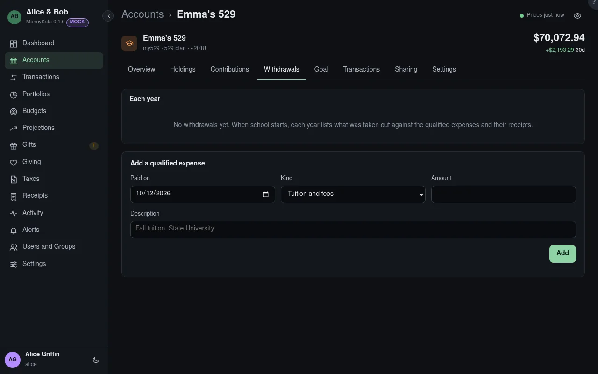

# Account: Withdrawals

What was taken out of a 529 each year, against the qualified expenses it paid for.

## Each year

Distributions (as on Form 1099-Q) against qualified expenses. What isn't covered may have taxable
earnings, with a 10% additional tax; your preparer applies the rules and coordinates them with
education credits.

## Add a qualified expense

Tuition and fees, room and board, books and supplies, a computer and internet, K-12 tuition,
apprenticeships, or student-loan repayment.

## Paid on {#paid-on}

The day it was paid. It counts in that tax year.

## Kind

Which qualified expense it is.

## Amount

What it cost.

## Description

What it was for: _Fall tuition, State University_.

## Qualified expenses

Each expense, with its receipts. **Receipt** keeps a bill or a statement with it.

## Receipts

A tuition bill, a housing statement or a receipt for books, kept with the expense.
