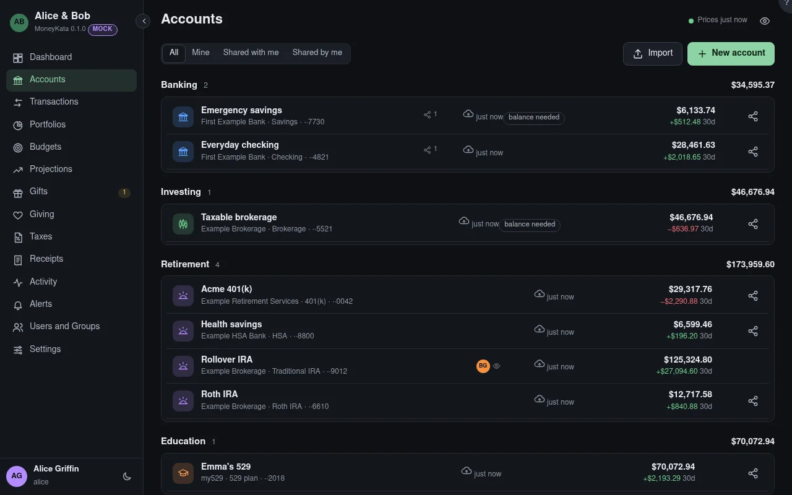

# Accounts

Every account you own or that someone has shared with you, grouped by kind.

## Show

**Mine**, **Shared with me** and **Shared by me**. A shared account shows its owner's avatar with an
eye (you can read it) or a pencil (you can change what it holds).

## Import

OFX, QFX or CSV from your bank or broker. Importing the same file again adds only what's new.

## New account

Pick the type first. It decides the fields, the tax treatment and the tabs the account has.

## Last updated

When the account last changed: its newest import or transaction.

## Mismatch

A balance the institution reported doesn't match MoneyKata's for that day. Open the account's
**Reconcile** tab to see what's suspect. **Balance needed** means none was reported for 45 days.

## Share

Opens the Share dialog for that account. Only its owner shares it.
