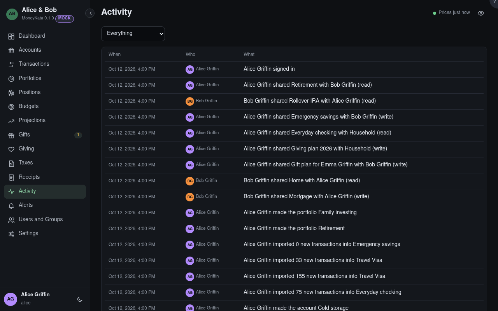

# Activity

What happened, newest first: who changed what. It never names an amount.

## Account

Shows what happened to one account.

## Who

The person, or MoneyKata itself for what a background task did, or the host for key commands run
there.

## +N new

Entries that arrived while you were reading. A click shows them.
