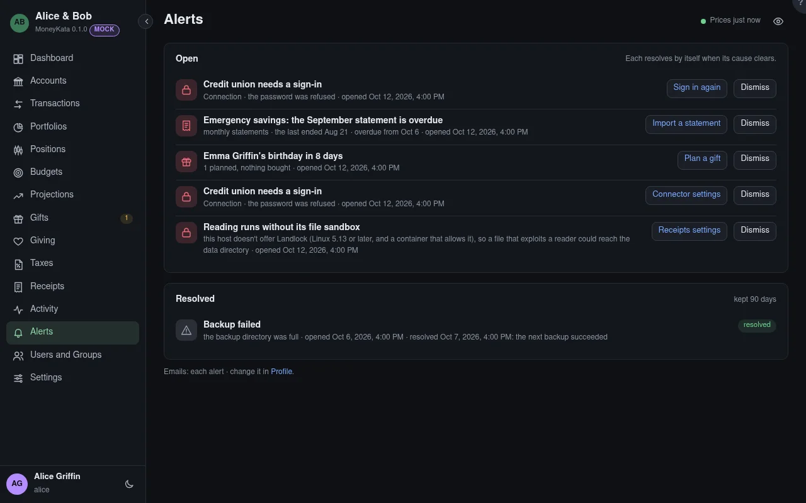

# Alerts

What needs you. Activity records what happened; an alert asks you to do something about it.

## Open

One alert per cause: a failing price source raises one alert, not one per try. It stays open while
the cause lasts and **resolves by itself** when the cause clears. The button beside it goes where to
fix it. **Dismiss** hides it for you alone; it stays open for anyone else it's for.

Admins are alerted about a price source or email failing for longer than Settings › Alerts allows, a
failed backup, and the yearly check of the master key's recovery phrase. An account's owner is
alerted when nothing has been imported into it for a month and a half, and when its balance has
disagreed with the institution's for a week.

## Resolved

Alerts whose cause cleared, kept for 90 days.

## Emails

Profile says how alerts reach you by email: each one as it opens, a daily summary, or none. They
never name an amount. Without email set up on the server, nothing is sent.
