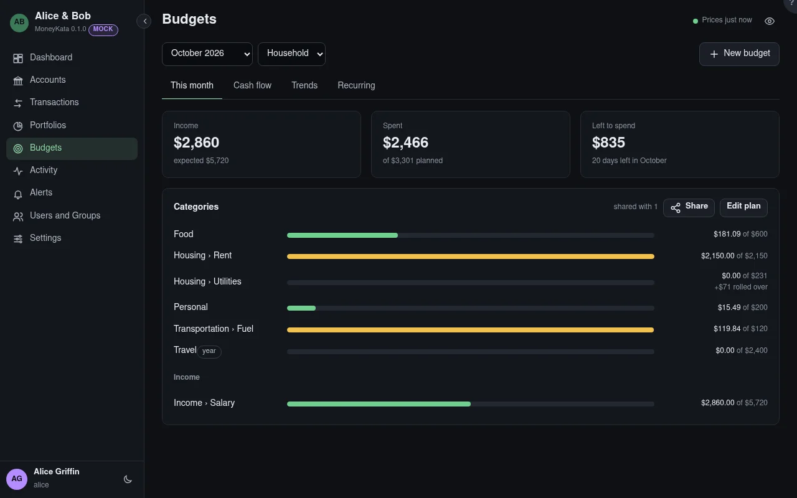

# Budgets

A budget plans spending per category over the accounts you choose, month by month. It is yours, or shared: share it with a group at **Write** for a household budget everyone in it plans and follows.

## Month

The month shown. Past months keep the plan they had; a change to the plan applies from the month it is made in.

## Budget

Which budget, when you have more than one or others share theirs with you.

## Categories

Each planned category's spending as a bar: green, then amber at 90% of the plan, red once over. A parent category counts its children. A category with **rollover** carries what was left (or overspent) into the next month. A **year** category compares the year so far with its yearly plan.

**Not in the plan** lists spending in categories without a plan. Transfers between your accounts never count.

## Edit plan

The amount per category from this month on. Anyone the budget is shared with at **Write** can change the plan; only its owner chooses its accounts or shares it.

## Uncategorised

Transactions in the budget's accounts with no category yet. Sort them on the Transactions screen, and they count.
