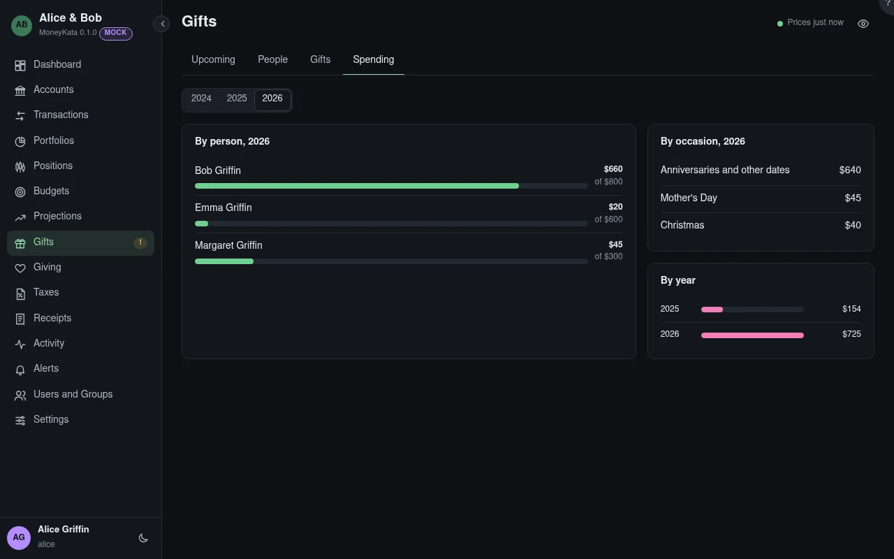

# Gifts: Spending

What gifts cost, by person against their budget, by occasion, and by year.

## Year

The year shown.

## By person

What was spent on each person this year against their yearly budget. A gift for several people
counts a share for each.

## By occasion

Birthdays, each holiday, and anniversaries and other dates.

## By year

Gift spending each year, to see how it grows.

Money given to one person in a year, cash gifts and contributions to their 529, above the annual
gift exclusion is flagged: a gift-tax return (Form 709) is needed, even when no tax is due.
