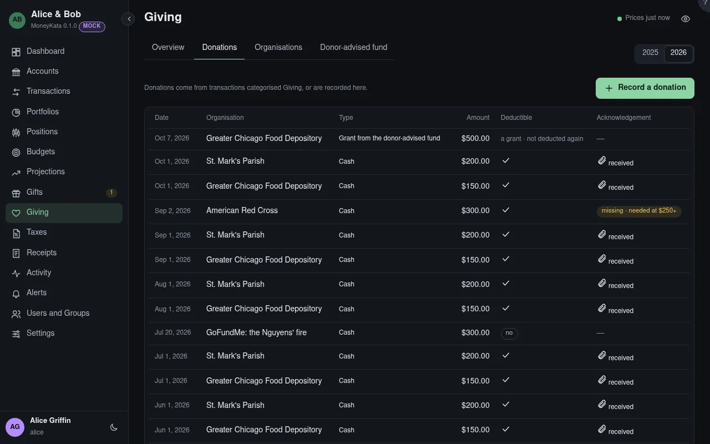

# Giving: Donations

Every donation in the year: those recorded here, and transactions categorised Giving.

## Year

The year shown.

## Record a donation

Cash, goods, appreciated shares, a qualified charitable distribution from an IRA, a contribution
into a donor-advised fund, or a grant from one.

## Donations

Each with its type, amount, whether it's deductible, and its acknowledgement. A written
acknowledgement is needed for any single gift of $250 or more; one that's missing is marked. A
transaction categorised Giving counts as cash until it's recorded with its organisation.
