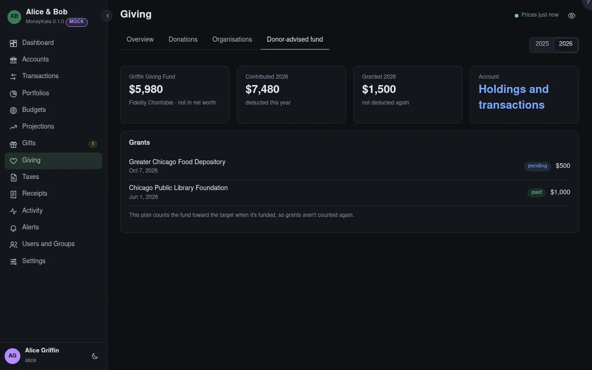

# Giving: Donor-advised fund

A donor-advised fund: what it holds, what went into it this year (deducted then), and the grants it
made (not deducted again).

## Year

The year shown.

## Grants

Each grant from the fund, pending until the fund pays it. Whether the fund counts toward the target
when it's funded or when it grants is the giving plan's choice; a dollar counts once either way.
