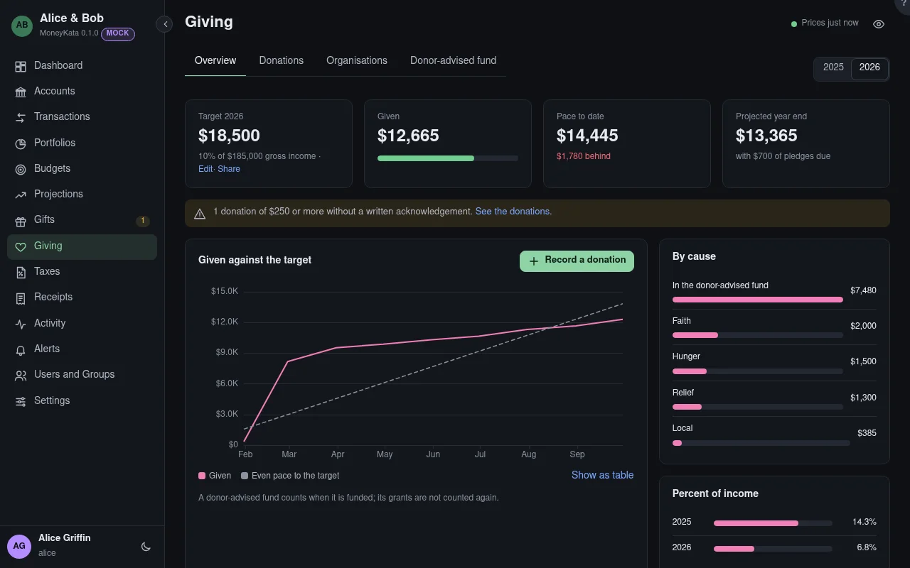

# Giving: Overview

The year's giving against its target: what was given, the even pace to the target, and where it
went.

## Year

The year shown.

## Target

The year's target, as a percentage of income or a fixed amount, from the giving plan. **Edit**
changes it; **Share** shares the plan, so a household gives toward one target.

## Given

Everything given this year that counts toward the target: a donor-advised fund once, when it's
funded or when it grants, as the plan says.

## Pace to date {#pace}

Where an even pace to the target would be by today, and how far ahead or behind you are.

## Projected year end {#projected}

What's given, plus the pledges still due this year.

## Given against the target

What was given by each month's end, against the even pace.

## By cause

What was given to each cause, from the organisations' causes; a gift to several causes is shared
between them.

## Percent of income

What was given each year as a percentage of income, over the last five years.

## By organisation

What each organisation received this year.
