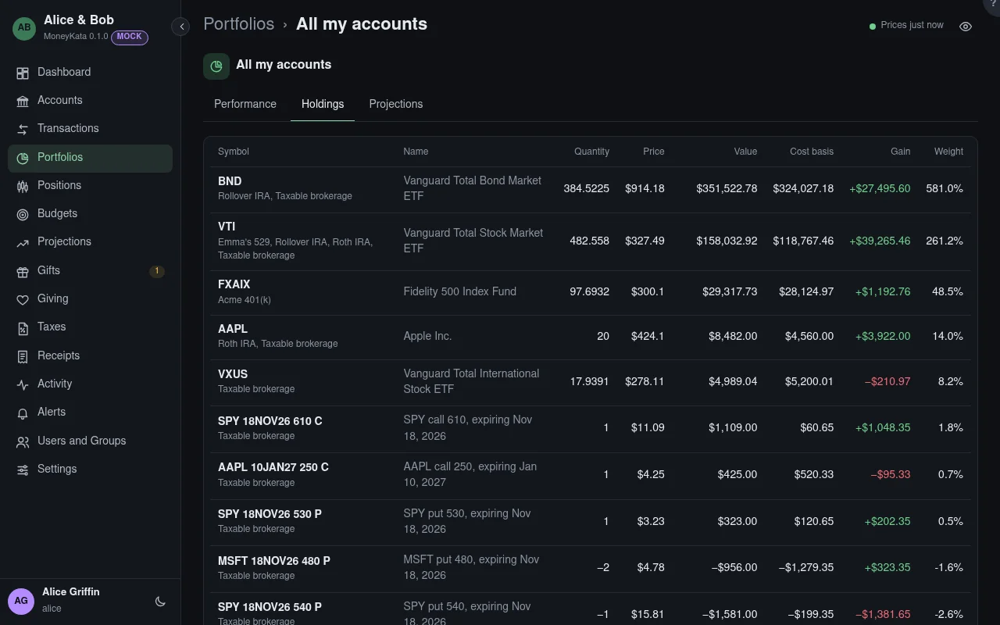

# Portfolio: Holdings

What the portfolio's accounts hold, added up by instrument.

## Weight

Each holding's share of the portfolio's value, cash included.

## Cost basis

What you paid for what you hold, fees included.

## Stale

A price older than it should be: two trading days for a stock, or 90 days for a typed price.

## Options · capital at risk {#capital-at-risk}

The options' market value in these accounts, and what they put at risk: each strategy's, and each
option on its own as a single leg.
