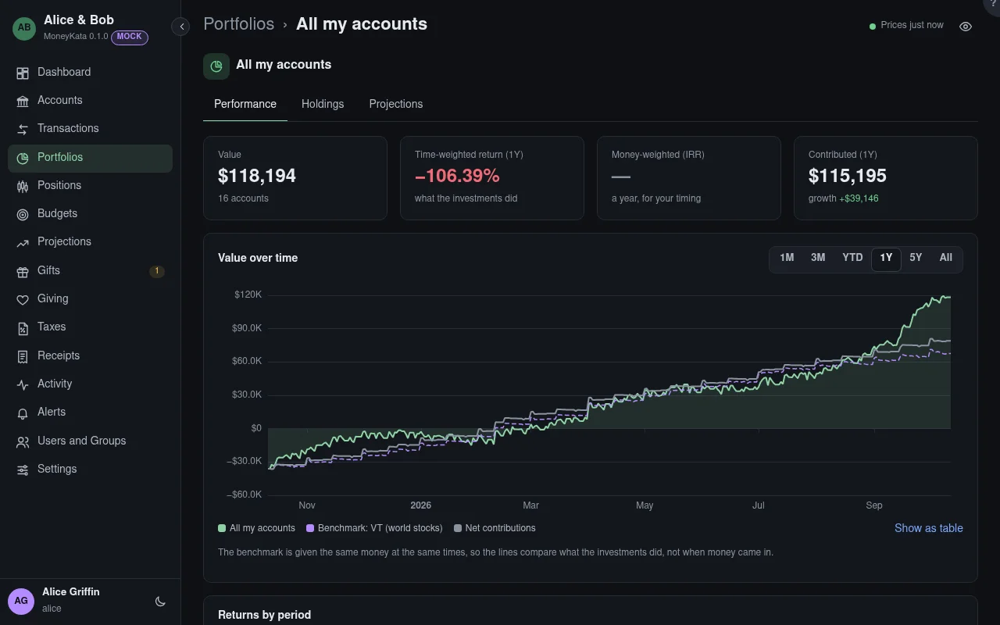

# Portfolio: Performance

How the portfolio grew, apart from the money you put in.

## Value

What the portfolio's accounts you can see are worth now.

## Time-weighted return

How the investments themselves did over the range, whatever you put in or took out and when: each day's growth chained together. Use it to compare with a benchmark or a fund.

## Money-weighted return (IRR) {#money-weighted-return}

Your own return, a year, counting when your money went in: money added before a rise earns more of it. It differs from the time-weighted return when you added or took money out.

## Contributed

What went in less what came out over the range. **Growth** is the change in value that wasn't contributed.

## Range

How far back the chart goes.

## Benchmark

The same money put into the benchmark on the same days: VT (world stocks), SPY (US large companies) or a 60/40 mix of VT and BND.

## Returns by period

The time-weighted return of each account and the portfolio. Three and five years are shown a year (annualised); a dash means the history doesn't go back that far.
