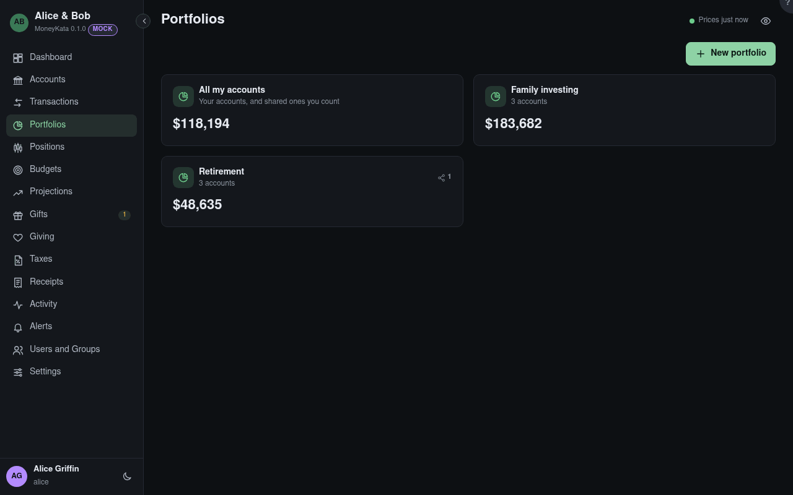

# Portfolios

Sets of accounts charted as one. **All my accounts** is everyone's first: your accounts, and shared
ones you count in your totals.

## New portfolio

A name, the accounts in it and the benchmark it's compared with.

## Shared portfolios

A portfolio shared with you shows only the accounts in it that are also shared with you; the rest
are left out of every figure.
