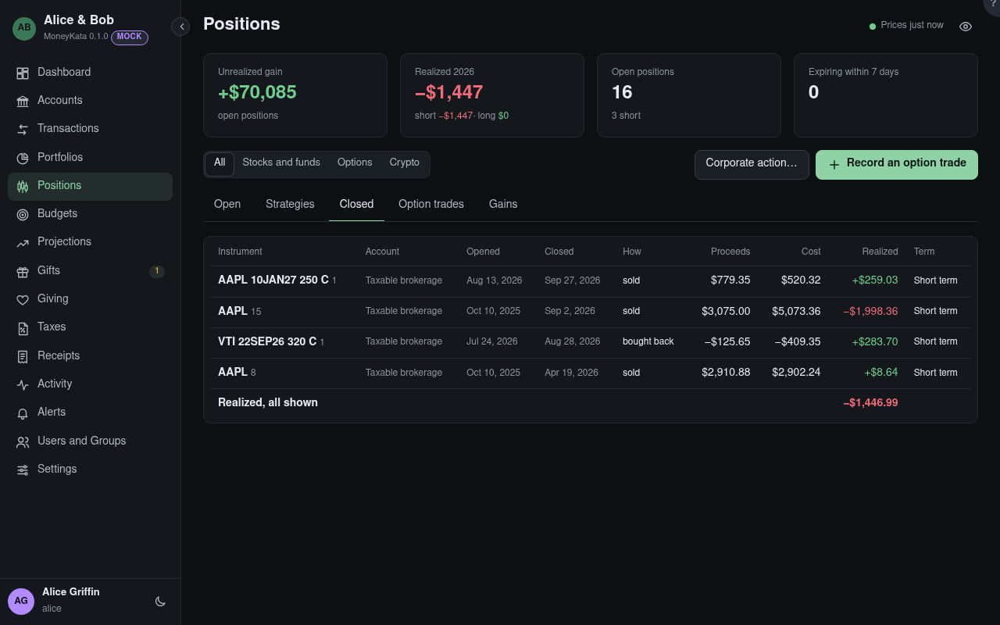

# Positions: Closed

Every closing trade: a sale, a buy to close, an expiry, an assignment.

## Show

All positions, or only stocks and funds, options, or crypto.

## Closing trades

When the position was opened and closed, how it closed, the proceeds, the cost, what was realized,
and whether short or long term. A **W** marks a wash
sale: a loss with the same instrument bought within 30 days either side, in any of your accounts
or your spouse's. The disallowed part is not realized; it moves into the replacement shares' basis,
with the sold shares' holding period.
