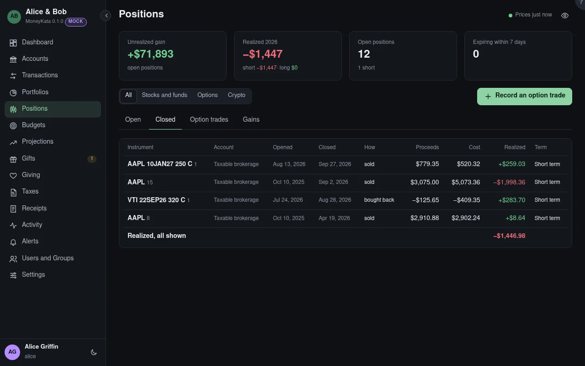

# Positions: Closed

Every closing trade: a sale, a buy to close, an expiry, an assignment.

## Show

All positions, or only stocks and funds, options, or crypto.

## Closing trades

When the position was opened and closed, how it closed, the proceeds, the cost, what was realized,
and whether short or long term.
