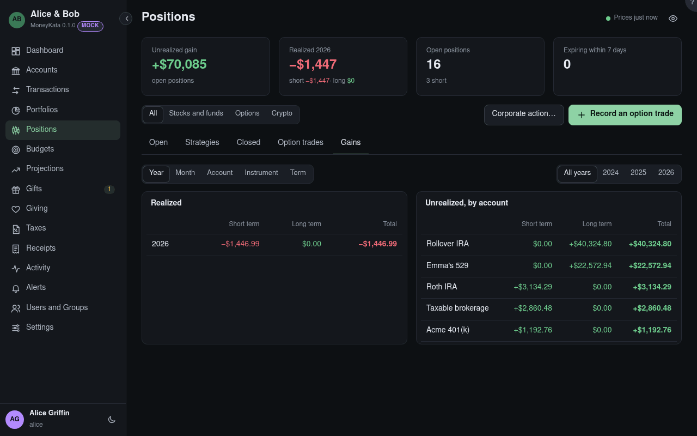

# Positions: Gains

Realized gains and losses grouped, and unrealized ones now.

## Show

All positions, or only stocks and funds, options, or crypto.

## By

Group by year, month, account, instrument, or short and long term.

## Year

One year's sales, or all of them.

## Realized

Each group's short- and long-term gains and losses.

## Unrealized

What open positions would realize if sold at the latest close, by account (or by instrument).
