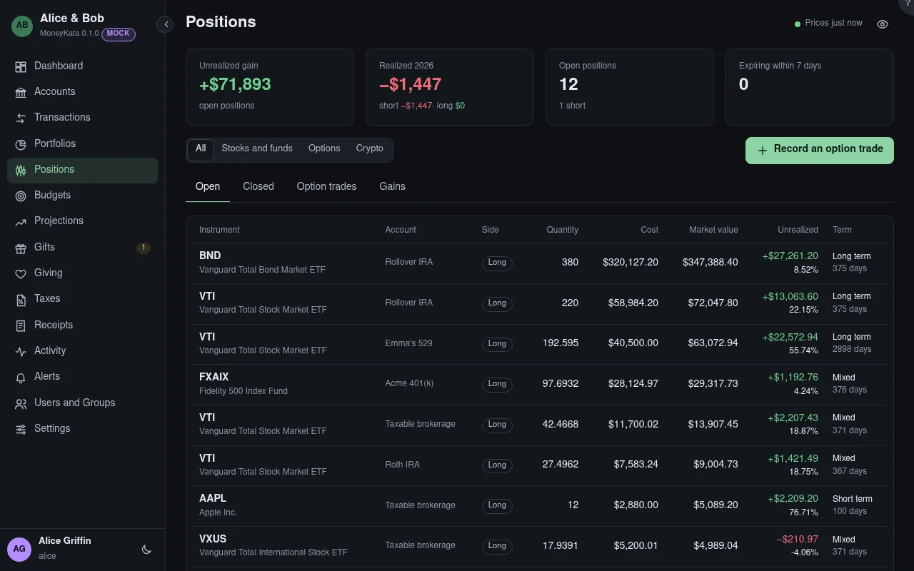

# Positions: Open

What you hold now, in every investing account you can see.

## Show

All positions, or only stocks and funds, options, or crypto.

## Open positions

Each instrument in each account: long or short, the quantity, its cost (for a short position, the
credit), the market value at the latest close, the unrealized gain or loss, and whether its lots are
short or long term. Click one for its lots: when each was bought, how long ago, and its basis. A lot
held more than a year is long term.
