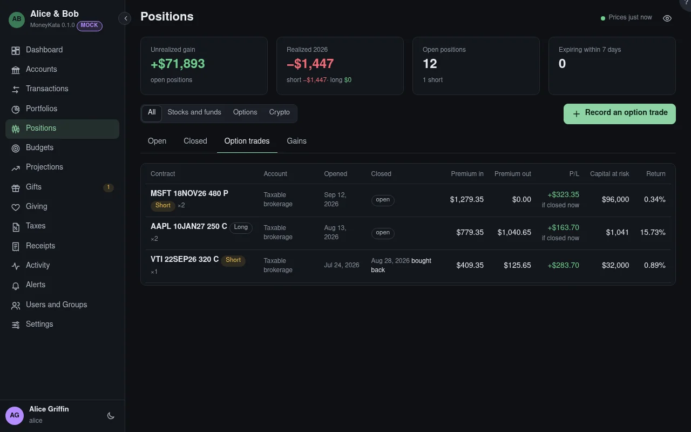

# Positions: Option trades

Each option trade from its first contract opened to its last one closed, with what it made.

## Show

All positions, or only stocks and funds, options, or crypto. Option trades are listed whichever
is chosen.

## Option trades

Each contract in each account: long or short and the most contracts open at once, when it was
opened and closed and how (sold, bought back, expired, assigned or exercised), the premium
received and paid (fees included), and the P/L. A trade still open shows the P/L if it were
closed at its current mark. An assigned or exercised option's premium is also folded into the
shares' basis or proceeds; here it is counted once, as the option's.

## Capital at risk {#capital-at-risk}

What the trade put at risk, and the return on it. A long option risks its premium. A short one
risks the strike on every share its contracts cover: the cash to buy them for a put, the shares
to deliver for a call.
