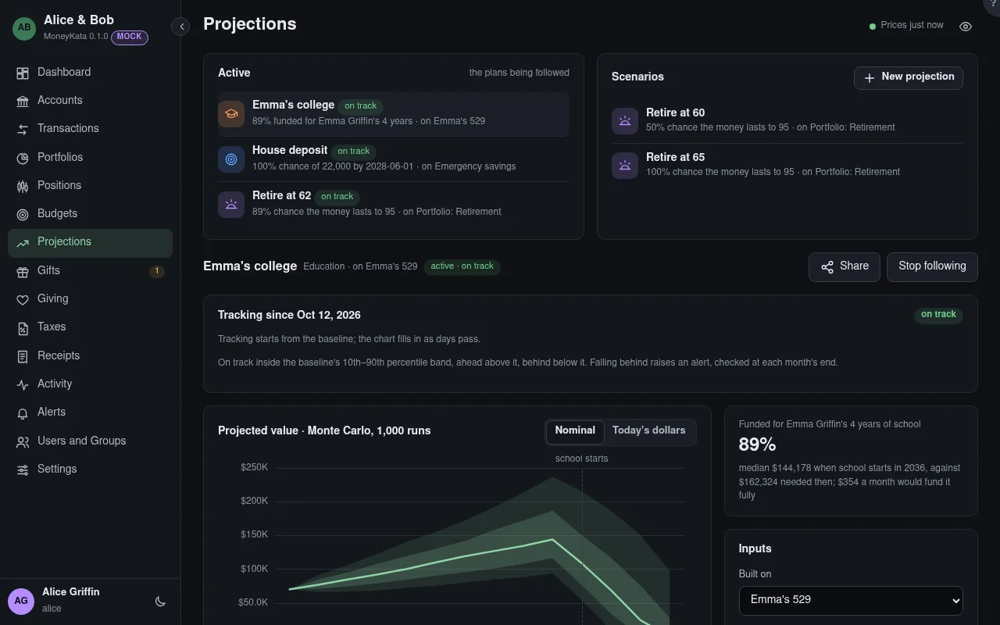

# Projections

How your money might grow toward a goal, and whether it will pay for it: **retirement**, or a **savings target** by a date. A model, not a forecast. (Education goals come with 529 accounts.)

## Active

The plans you follow. At most one per subject: one retirement plan for the same people, one per savings target. Making one active stores its median path and its 10th–90th percentile band as of that day: its **baseline**.

## Scenarios

Projections that aren't active: what-ifs to compare, such as retiring at 60 against 65, or saving $500 more a month. **New projection** starts one.

## Tracking

For an active projection, the actual balance of what it is built on against its baseline: **on track** inside the band, **ahead** above it, **behind** below it. Falling behind raises an alert, checked at each month's end.

## Show on my Dashboard {#show-on-dashboard}

For an active projection someone shares with you: show it on your Dashboard's Plans card. Off by default.

## Dollars

**Nominal** dollars as they will be; **today's dollars** take inflation out.

## Built on

A portfolio, an account, or a typed amount for a what-if. Built on accounts, it starts from their value today and their mix of asset classes; each class follows your assumptions in Profile.

## Amount {#typed-amount}

The typed amount it starts from.

## Retirement age

When you retire: contributions stop, and withdrawals start, when the last of the people in it retires.

## Partner retirement age

Your partner's, for a couple.

## Contribution per year {#contribution}

What is added each year until retirement.

## Grows yearly by (%) {#contribution-growth}

How much the contribution rises each year, with your pay.

## Withdrawal

How much is taken each year in retirement: the **4% rule** (4% of the balance at retirement, then rising with inflation), a **fixed amount** rising with inflation, or a **percentage** of each year's balance.

## Withdrawal a year, in today's dollars {#withdrawal-amount}

The fixed amount, before inflation.

## Percentage of the balance {#withdrawal-percent}

Taken from each year's balance.

## Other income {#other-income}

Social Security or a pension, from an age, a month. It covers part of each withdrawal.

## Target amount {#target}

What the savings target is.

## Target date

By when.

## Saving per month {#monthly}

What goes in each month until then. The answer says what a month would reach it with a 90% chance.

## Fees a year (%) {#fees}

Fund and advisory fees, taken from the balance each year.

## Bitcoin model

For the bitcoin in what it is built on: your crypto assumption, or a model others publish. A model with bear, base and bull cases shows those three paths instead of a fan.

## Run

Saves the inputs and works it out again. For an active projection it asks whether to move the baseline to the new inputs.
