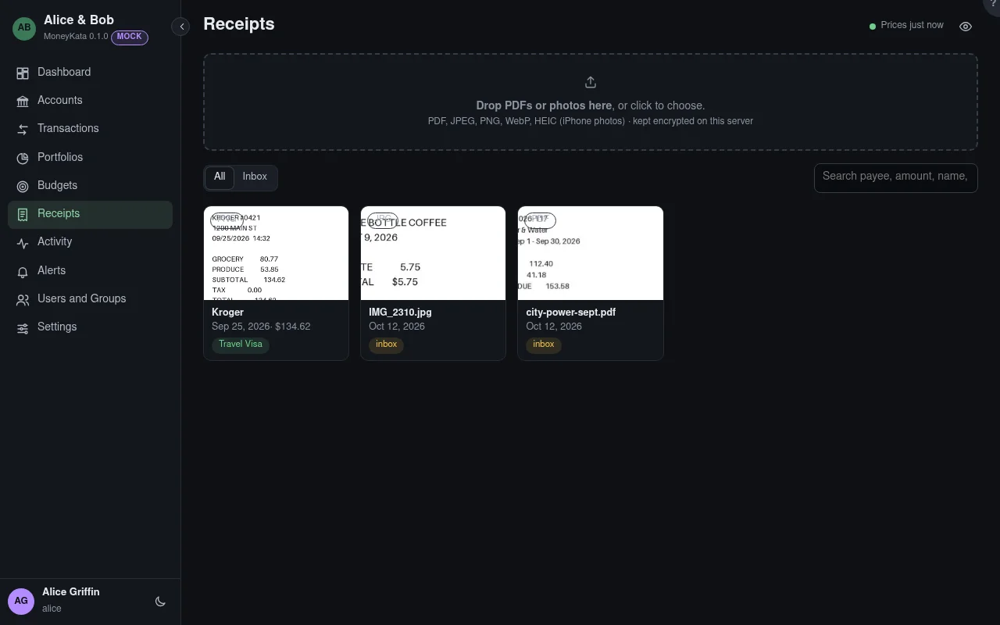

# Receipts

PDFs and photos of receipts, invoices and statements, kept encrypted on this server and attached to the transactions they belong to.

## Drop PDFs or photos here {#receipt-files}

PDF, JPEG, PNG, WebP and HEIC (iPhone photos), many at once, each up to the size in Settings › Receipts. The type is checked from the file itself. A file you already uploaded isn't stored twice: you get the receipt you have.

## Show

**All** your receipts, and those attached to transactions in accounts shared with you; or the **Inbox**: your receipts attached to nothing yet.

## Search

Matches the payee, amount, file name, notes and tags.

## Sharing

A receipt is seen by whoever can read a transaction it is attached to. One attached to nothing is yours alone. Only you can delete your receipt, and only once nothing links to it.
