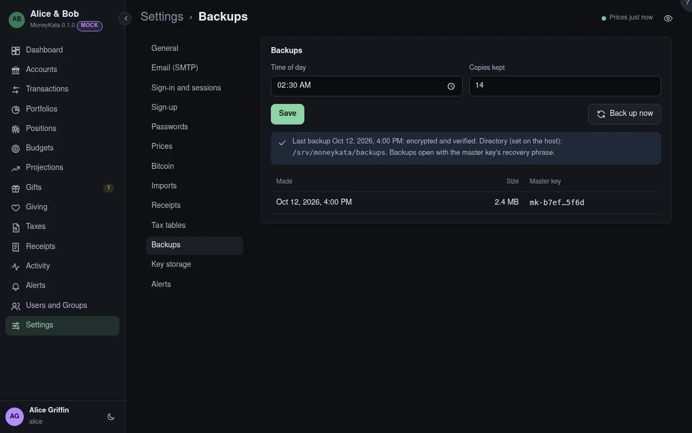

# Settings: Backups

Daily copies of the database with its keyring, made, checked and pruned by the server. Never
the receipt files: the host backs up the data directory, files and all, and this copy exists so
that the live database the host picks up has a coherent, verified twin beside it. The backup
directory belongs inside what the host backs up.

## Time of day

When the daily backup runs.

## Copies kept

How many backups stay; older ones are deleted. 14 by default.

## Back up now

Makes a backup now.

## Restoring

Backups are encrypted as the data is, and open with the recovery phrase of their day; each
carries its own keyring, and a rotation re-encrypts it when told to. A restore puts the database
and keyring back and leaves the receipt files where they are, re-wrapped to the backup's key when
a re-encryption came between. The directory is set on the host, outside the data directory.
