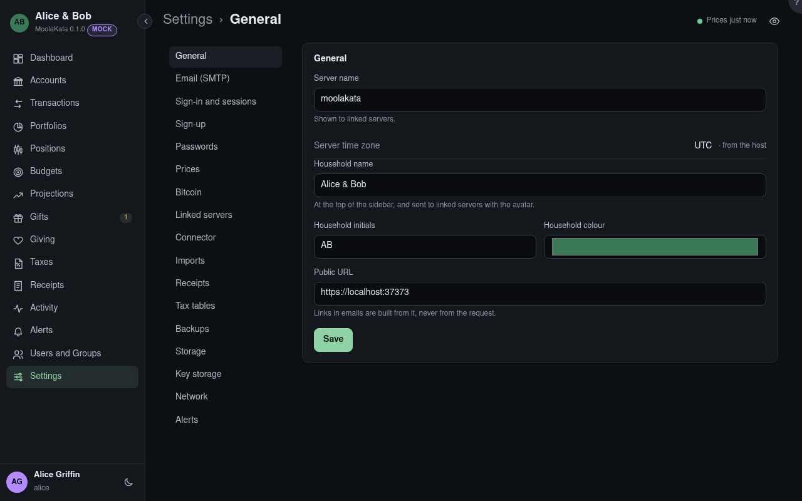

# Settings: General

The server's name and the household it belongs to.

## Server name

Shown to linked servers.

## Server time zone

Read from the host. A user whose time zone is **Auto** sees times in it.

## Household name

At the top of the sidebar.

## Household initials

The household's avatar.

## Household colour

The avatar's colour.

## Public URL

The address people reach MoolaKata at, such as `https://money.example.lan`. Links in emails
(invitations, resets) are built from it, never from the request.
