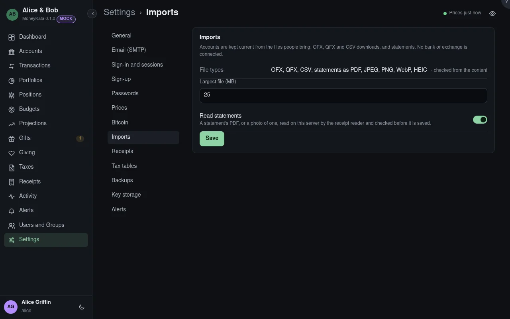

# Settings: Imports

## File types

OFX, QFX and CSV, and statements as PDF, JPEG, PNG, WebP or HEIC, checked from what's inside the file, never its name.

## Largest file {#largest-file}

The biggest file that can be imported, in MB.

## Read statements

Whether a statement's PDF or photo can be imported. It is read on this server by the receipt reader, in its own process, and checked by the person before anything is saved. Off, only OFX, QFX and CSV files import.
