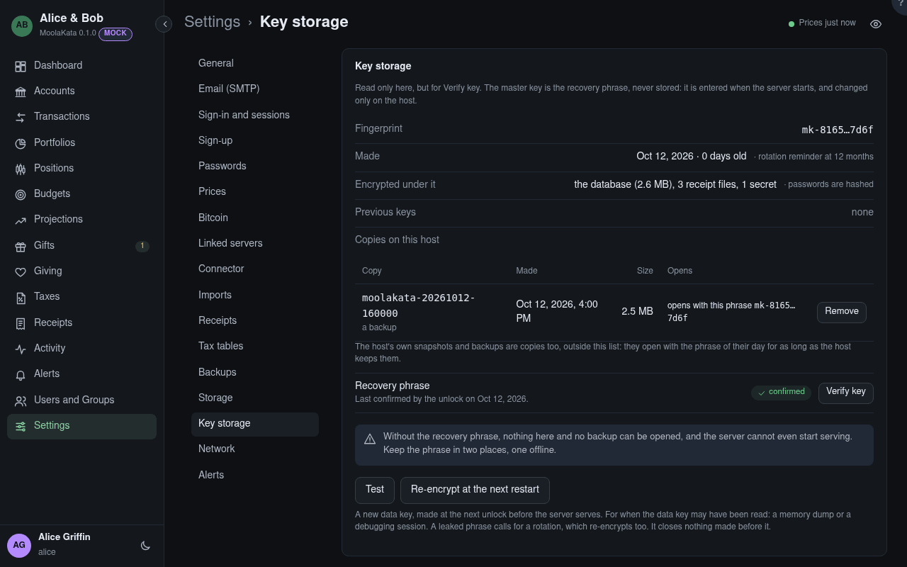

# Settings: Key storage

Read only, but for **Verify key**. Everything the server stores is encrypted under one master
key, which is the recovery phrase: never stored, entered when the server starts, and changed only
on the host.

## Fingerprint

A short name for the key that reveals nothing about it, such as `mk-3f9a…c21e`.

## Unlocked

When the phrase was last entered. The server locks again at every restart, until someone
enters the phrase on the locked screen or with `moneykata keys unlock` on the host.

## Recovery phrase

The master key written as 12 words. The welcome showed it once, when the server was new, and
nothing shows it again: without it nothing here, no backup, and no restart of the server opens.

## Verify key

Type the 12 words from one of your copies: MoneyKata checks that they open this server's key,
changes nothing, and records the check. Do it once a year for each copy, and whenever you make a
new one; the yearly alert opens it. `moneykata keys verify` on the host does the same.

## Test

Checks that the keyring on disk is the one the phrase unlocked, and that the database and a
secret open with the data key.

## Previous keys

The master keys this server was rotated away from, each with how many copies on this host still
need its phrase. A rotation re-encrypts every copy it is told to, so the count is usually none; the
host's own snapshots and backups made before the rotation still open with that phrase for as
long as the host keeps them, and are yours to count. **Forget** drops a key from the list once
nothing needs it; destroy its sheet and password-manager entry then.

## Copies on this host

Every copy MoneyKata can see: the backups in the backup directory, the copies made before a
migration (`pre-upgrade/`) and what a restore set aside (`before-restore-*/`). Each carries its
own keyring and says how it opens: with this phrase, with this phrase but an earlier data key,
or only with a previous phrase. **Remove** deletes one, after your password. The host's own
snapshots and backups are copies too, outside this list.

## Re-encrypt at the next restart

Schedules a new data key for the database, the receipt files and every secret. It never runs
while the server serves: the next unlock runs it first, after a verified backup, with the phrase
given there wrapping the new key, its progress on the locked screen. It asks for your password
again. Until it begins, **Cancel it** drops it; once begun, it finishes at the next unlock. A
rotation on the host schedules one too, since a rotation always re-encrypts.

## Scheduled {#scheduled}

A re-encryption waiting for the next restart, and whether it has begun.

## After a restore {#after-restore}

The first unlock after a restore opens every receipt file and secret with the restored keys,
and lists here what doesn't open: receipts to put back from the host's own backup of the same
moment, and secrets to enter again. A receipt file that opened under no key was set aside in
`receipts-set-aside/` in the data directory.

## The copies on this host {#copies-at-re-encryption}

For each copy, what the re-encryption does with it: **Re-encrypt** (the default) rewrites it
under the new data key, after the main job; **Delete** removes it; **Leave as it is** keeps it
under its old data key, which this phrase still opens. A copy under an earlier phrase cannot be
rewritten: leave it or delete it.
For when the data key may have been read: a memory dump or a debugging session on the live server,
or a master key or recovery phrase that leaked while any copy of the data directory or a backup
could have been taken with it. It closes nothing made before it: every earlier copy still opens
with the key it was made under, so a leak also means deleting those copies wherever they are. It
doesn't change the master key, which is rotated on the host with `moneykata keys rotate`.
