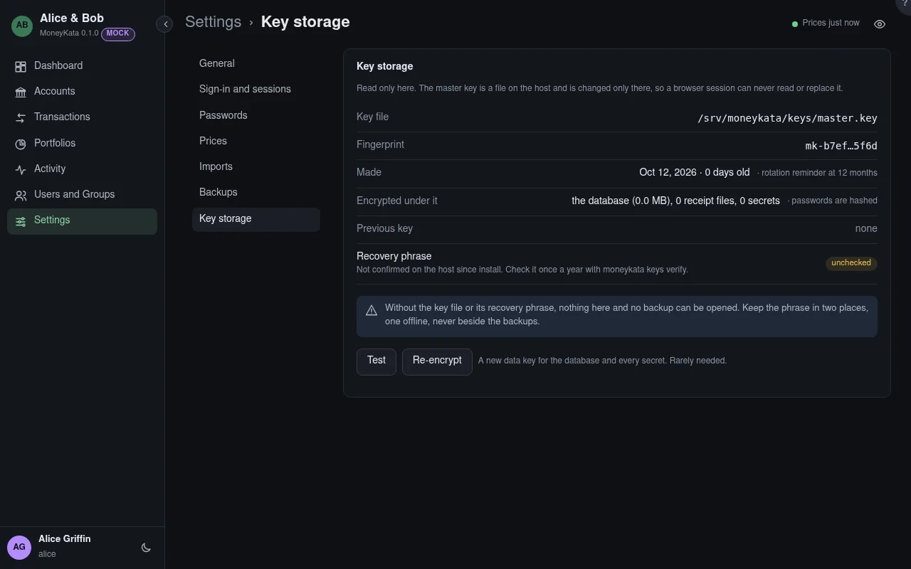

# Settings: Key storage

Read only. Everything the server stores is encrypted under one master key, a file on the host.

## Fingerprint

A short name for the key that reveals nothing about it, such as `mk-3f9a…c21e`.

## Recovery phrase

The master key written as 12 words, the only way back if the key file is lost. Check a copy once a
year on the host with `moneykata keys verify`.

## Test

Checks the key file, unwraps the data key and opens the database and a secret.

## Re-encrypt

Makes a new data key and re-encrypts the database and every secret under it. Rarely needed: only
when the data key may have been exposed. It doesn't change the master key, which is rotated on the
host with `moneykata keys rotate`.
