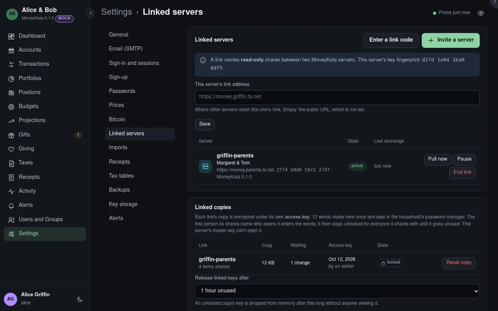

# Linked servers

Other MoneyKata servers that share read-only with this one: another household's, or a
preparer's. Admins only.

**Invite a server** makes a one-time code for the other server's admin. **Enter a link code**
answers one: MoneyKata connects to the address in the code, checks the server's key against the
fingerprint in it, and asks to link. The inviting side then lists it as **wants to link**: compare
the fingerprint shown with what the other admin sees for their own server (by phone, in person)
and **Approve** or **Reject** it.

## This server's link address {#link-address}

Where other servers reach this one, as `https://…` without a path: MoneyKata answers them under
`/link/`. It must be reachable from the other server: a forwarded port, a reverse proxy that
passes `/link/`, or both servers on one overlay network such as Tailscale or WireGuard (the easy
way, with no open port). Empty, the public URL is used.

A link works when either side can reach the other: each exchange carries both directions.

Each link shows its state, its fingerprint and MoneyKata version, and when the last exchange
worked. **Pull now** exchanges at once rather than at the next hour. **Pause** stops this side
exchanging until **Resume**. **End link** ends it on both sides: the other side learns at once, or
at its next call; its users are removed here, and nothing is deleted on the server that shared.
A server that can't be reached shows **unreachable since** and the reason.

## Users on linked servers {#linked-users}

Each linked server's active users, sent at every exchange and updated in place: a new user is
added, a changed name or email is updated, and a user no longer on the list is removed (and comes
back if they return). People here can share with them, always read only. They never sign in here,
join a group, own anything or receive alerts.
