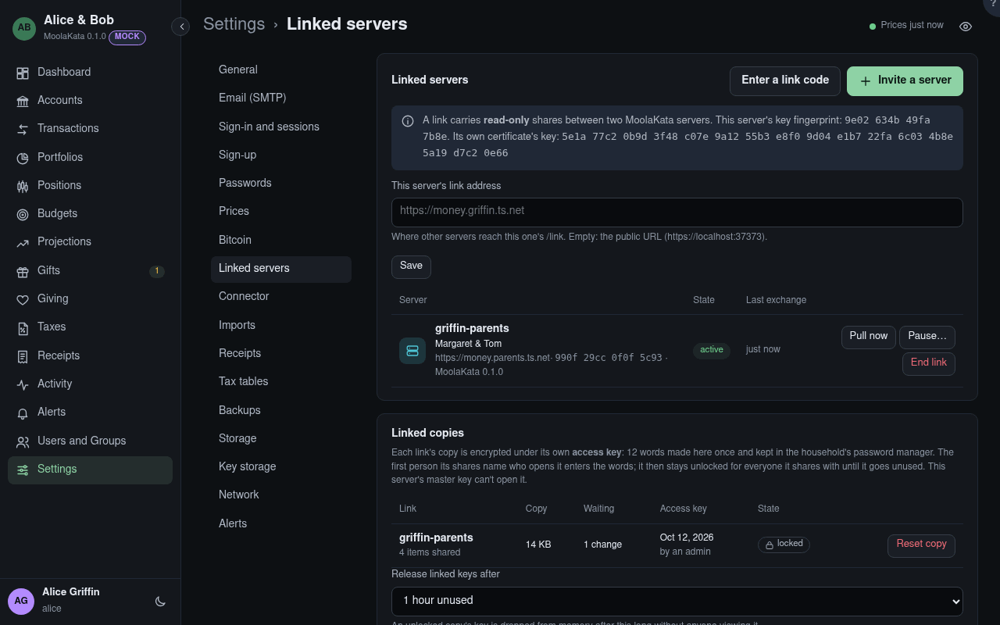

# Linked servers

Other MoolaKata servers that share read-only with this one: another household's, or a
preparer's. Admins only.

**Invite a server** makes a one-time code for the other server's admin. **Enter a link code**
answers one: MoolaKata connects to the address in the code, checks the server's key against the
fingerprint in it, and asks to link. The inviting side then lists it as **wants to link**: compare
the fingerprint shown with what the other admin sees for their own server (by phone, in person)
and **Approve** or **Reject** it.

## This server's link address {#link-address}

Where other servers reach this one, as `https://…` without a path: MoolaKata answers them under
`/link/`. It must be reachable from the other server: a forwarded port, a reverse proxy that
passes `/link/`, or both servers on one overlay network such as Tailscale or WireGuard (the easy
way, with no open port). Empty, the public URL is used.

A link works when either side can reach the other: each exchange carries both directions.

Each link shows its state, its fingerprint and MoolaKata version, and when the last exchange
worked. **Pull now** exchanges at once rather than at the next hour. **Pause** stops this side
exchanging for a time you choose; it shows **paused until** then and resumes on its own, or at
once with **Resume now**. **End link** ends it on both sides: the other side learns at once, or
at its next call; its users are removed here, and nothing is deleted on the server that shared.
A server that can't be reached shows **unreachable since** and the reason. One that answers it
has no link with this one (restored from an older backup, say) shows **broken**: end the link, or
link again. Only the other server ending the link ends it here.

What crosses a link is sealed by the server that sends it to the receiving copy's key, so
nothing between the two servers, not even a proxy in front of one of them, reads it.

## Its certificate changed {#certificate-changed}

The connection to each server is TLS, checked before anything is sent: a public certificate
against the system's trusted roots, and a server's own certificate by its key, pinned when the
link was made. A server whose own certificate's key changes tells its peers first. One that
presents a key it didn't announce is refused, and the link shows the new key: ask its admin to
read out **Its own certificate's key** from their Linked servers, compare it, and **Accept it**
(it asks for your password again). This server's own certificate's key, when it has one of its
own, is shown at the top of this section.

## Syncing {#progress}

A large change, such as the first pull into a new copy, arrives in parts of about 4 MB, oldest
first, so what has arrived is usable at once. While parts are still coming the link shows the date
it has reached and how much of the change has arrived.

## Linked copies {#linked-copies}

What each link brings in is kept apart from this household's data, in its own encrypted copy under
its own **access key**: 12 words. This server's master key can't open it, and backups leave it
out. **Create the access key** once the link is active: MoolaKata shows the words once, for the
household's password manager, where the people its shares name can reach them. Pulls into the copy
begin then.

The first person its shares name who opens the household's window enters the words; the copy then
stays unlocked for everyone it shares with, each seeing only what names them, until it goes unused.
Each copy shows its size, the changes **waiting** (pulled while it was locked, sealed so only its
words open them, and applied when it is next unlocked), when its key was made and by whom, and who
unlocked it. **Lock now**
locks it at once. **Reset copy** (if the words are lost) deletes the copy and its key: make a new
access key, and everything is pulled again from the other server, where nothing was lost.

## Release linked keys after {#link-release}

How long an unlocked copy's key stays in memory with nobody viewing it: 15 minutes, 1 hour (the
default) or 4 hours. Background work, such as a pull, doesn't count as viewing. A restart locks
every copy.

## Shared from here {#outgoing}

What this server sends each linked server at its pulls: each item shared with people there, by
its kind and its owner here, since when, and the people there it names. They see it read only,
and only what changes travels after the first pull.

## Shared from a linked server {#incoming}

What each linked server shares with people here, as an admin sees it: only its kind, its owner's
name, when it was shared and the people here it names. Its name and figures stay inside the
encrypted copy, for those people. The owner there decides who sees what; an admin here can't
change it, and nothing shared from there can be shared on.

## Users on linked servers {#linked-users}

Each linked server's active users, sent at every exchange and updated in place: a new user is
added, a changed name or email is updated, and a user no longer on the list is removed (and comes
back if they return). People here can share with them, always read only. They never sign in here,
join a group, own anything or receive alerts.
