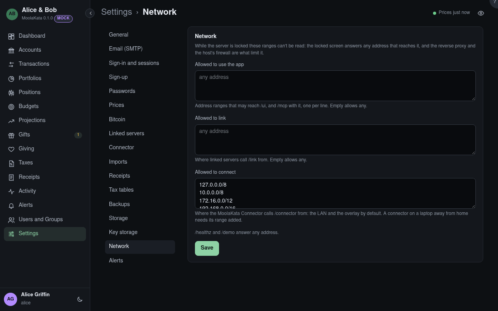

# Network

Which addresses may reach each part of this server. Each list holds address ranges, one per
line, as `192.168.1.0/24` or a single address; an empty list allows any address. A change
applies to the next request. Addresses outside a list get *not found*, as if the path didn't
exist. `/healthz` and `/demo` answer any address. Admins only.

The lists are kept in the database, which can't be read while the server is locked. So until the
phrase is given, the locked screen and the unlock answer any address that reaches the listener:
the reverse proxy in front of MoolaKata, and the host's firewall, are what limit them.

## Allowed to use the app {#network-app-ranges}

The ranges that may reach the app (`/ui`), and `/mcp` with it, since an agent sits where a
person's browser does and its token is already the user's. Empty by default: any address the
host's port mapping and firewall let through.

## Allowed to link {#network-link-ranges}

Where linked servers call `/link` from: an overlay network's range (Tailscale uses
`100.64.0.0/10`), or the other household's address. Empty by default.

## Allowed to connect {#network-connector-ranges}

Where the MoolaKata Connector calls `/connector` from. By default the LAN and the overlay
(`10.0.0.0/8`, `172.16.0.0/12`, `192.168.0.0/16`, `100.64.0.0/10`, loopback and the private
IPv6 range), so a connector beside the server or on the household's overlay works as it is. A
connector on a laptop away from home needs the range it calls from added here.

Changing any of these asks for your password again when it was given over 10 minutes ago: a
wider range lets more addresses reach the server.
