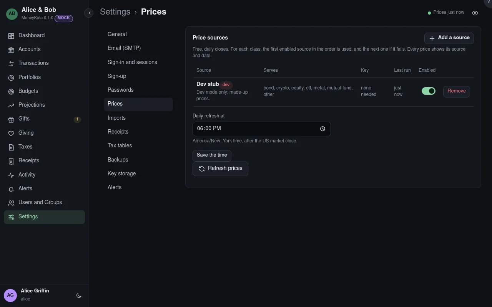

# Settings: Prices

Where daily closes come from. Prices are free and daily, never live.

## Price sources

The sources added, each with the classes it serves. For each class the first enabled source is used,
and the next one when it fails.

## Add a source

Every source MoneyKata ships. One that needs a key can't be enabled until its key is set.

## Enabled {#enabled}

Whether the source is used.

## Key

A source's key is stored encrypted and never shown again: only that it is set, when and by whom.

## Last run

When the source was last used, and its last error.

## Daily refresh at

When the daily refresh runs, after the US market close. 6:00 PM Eastern by default.

## Refresh prices

Runs the daily refresh now.

{{part prices-tiingo}} {{part prices-coinbase}} {{part prices-manual}}
