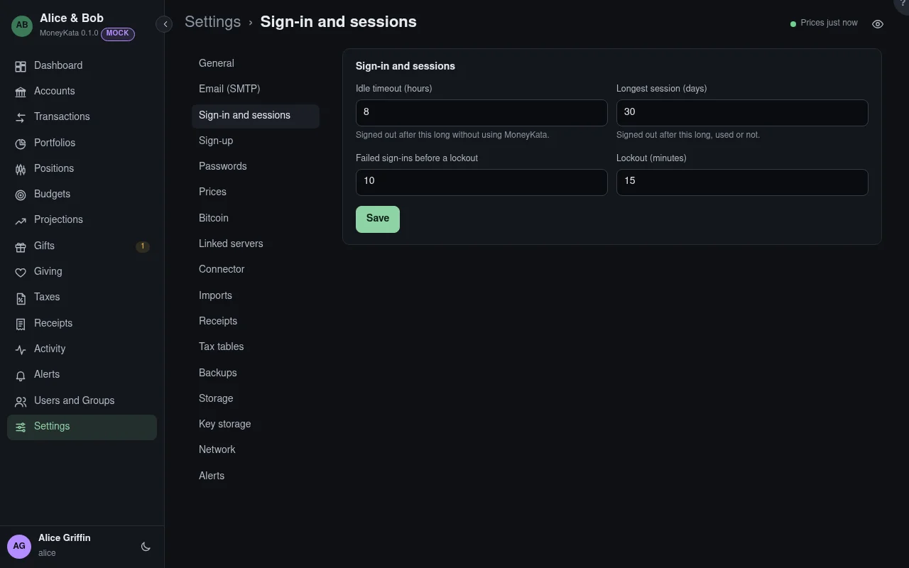

# Settings: Sign-in and sessions

How long a sign-in lasts and when repeated failures lock a username.

## Idle timeout {#idle-timeout}

Hours without using MoneyKata before a session ends. 8 by default.

## Longest session {#longest-session}

Days a session lasts, used or not. 30 by default.

## Failed sign-ins before a lockout

Wrong passwords in 15 minutes that lock the username. 10 by default.

## Lockout {#lockout}

Minutes a locked username waits. 15 by default.
