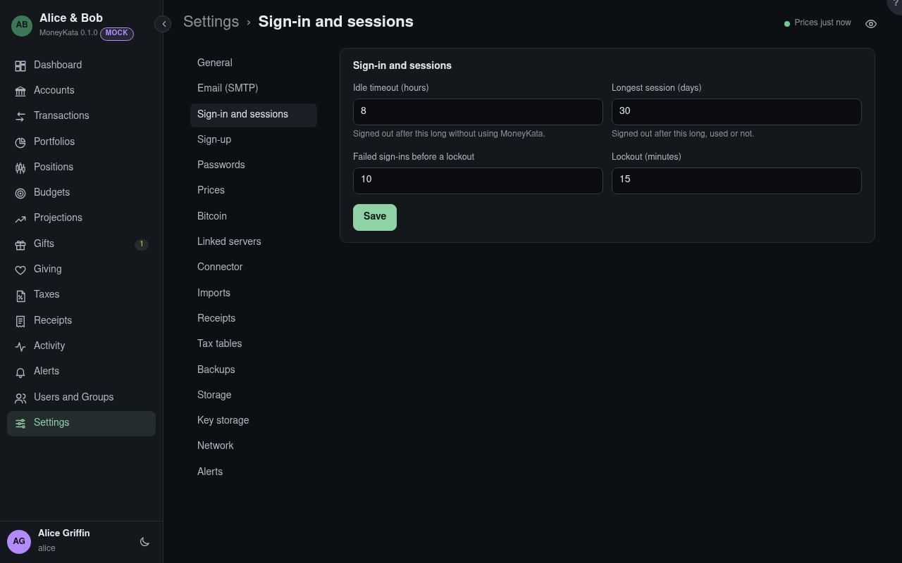

# Settings: Sign-in and sessions

How long a sign-in lasts and when repeated failures lock the address they come from.

## Idle timeout {#idle-timeout}

Hours without using MoneyKata before a session ends. 8 by default.

## Longest session {#longest-session}

Days a session lasts, used or not. 30 by default.

## Failed sign-ins before a lockout

Wrong passwords or codes in 15 minutes, from one address, that lock that address. 10 by
default. A username that keeps failing, from anywhere, is only slowed, never locked, so nobody
can lock an admin out by typing wrong passwords from afar.

## Lockout {#lockout}

Minutes a locked address waits. 15 by default.
