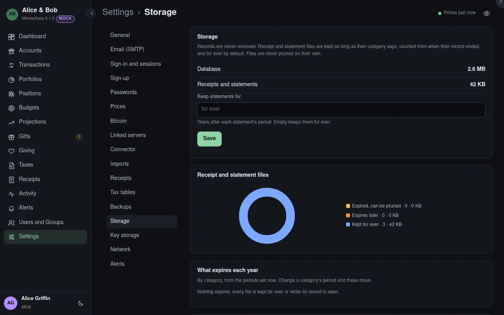

# Settings: Storage

How much the database and the files take, and how long receipt and statement files are kept.
Records are never removed: only files whose retention has run out, and only when an admin prunes
them here. Sizes and counts only, never what the files hold.

## Prune

Opens the files that have expired, by category, to prune: a verified backup first, then the files.

## Keep statements for {#keep-statements-years}

Years after each statement's period. Empty keeps them for ever, the default.

## Receipt and statement files {#files}

The files expired and prunable, those that expire later or are kept while their record is open,
and those kept for ever.

## What expires each year {#what-expires-each-year}

By category, from the periods set now: change a category's period and these move.

## Keep receipts for {#keep-receipts-for}

Each category's period: years after the record a receipt is attached to ended. A subcategory
without its own takes its parent's; empty keeps them for ever, the default.
