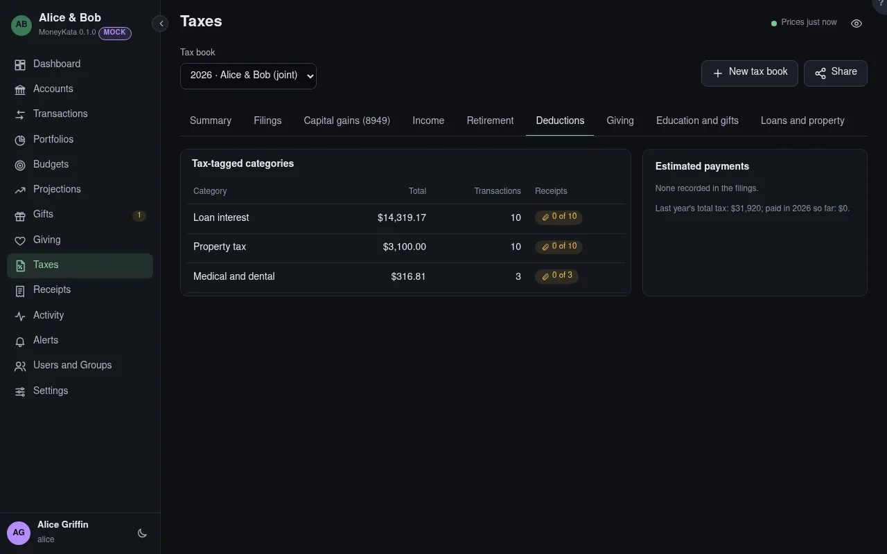

# Taxes: Deductions

Totals of the tax-tagged categories, with the receipts behind them, and the estimated tax payments.

## Tax book

The book shown, for one tax year. Its panels count the book's accounts only, and say which were left
out.

## Tax-tagged categories

Medical, childcare, education, charitable, business and loan interest: each category's total in the
year, its transactions, and how many have a receipt attached.

## Estimated payments

Each quarter's estimated payment from the filings, beside last year's total tax.

## Dependents' ages on Dec 31 {#dependents-ages}

Each dependent's age at the end of the year: under 17 for the child tax credit, under 13 for the
childcare credit, and what they age out of this year.
