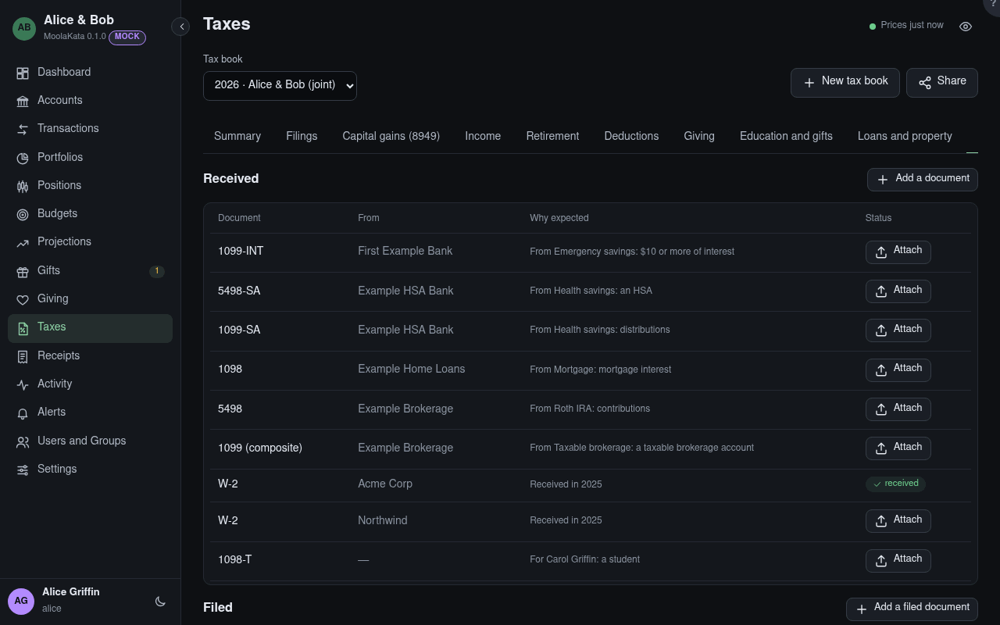

# Taxes: Documents

The documents for the year: those received, against those expected, and those filed.

## Tax book

The book shown: one tax year, for you alone or for you and your spouse filing jointly. **New tax
book** starts the next one; **Share** lets someone help, such as a preparer with an account here or
a grown child.

## Received

W-2s, 1099s, 1098s and the like, expected from the accounts counted and from last year's documents.
**Attach** keeps the PDF or a photo with your receipts and marks it received.

## Filed

The return as filed, the e-file acknowledgement, an extension, and what the tax authority sends:
notices, letters, your replies, transcripts. MoolaKata doesn't produce these; it keeps them because
next year often needs them.
