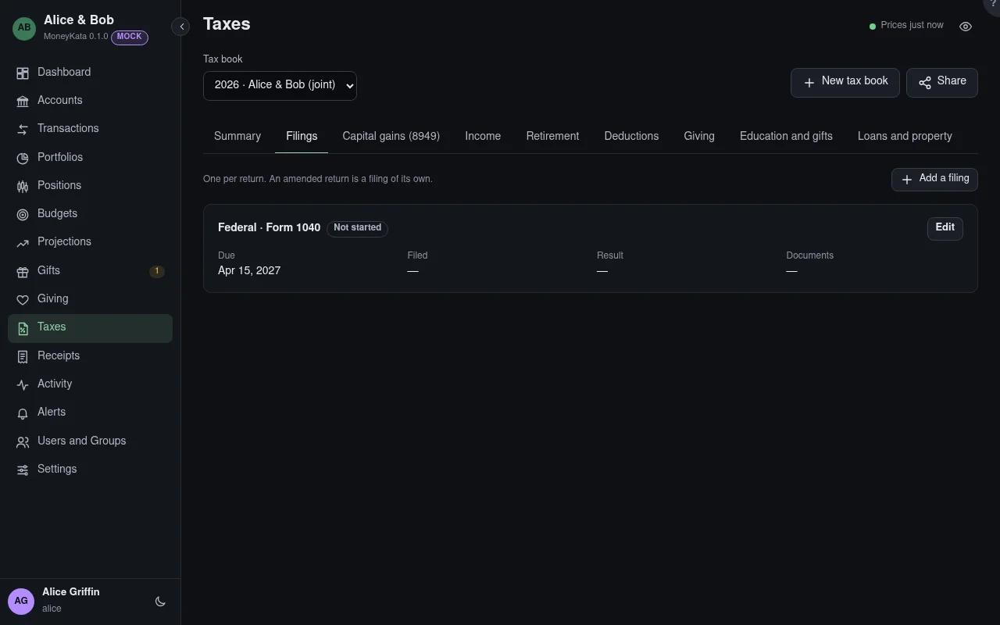

# Taxes: Filings

One filing per return: federal, a state's or a locality's. An amended return is a filing of its own.

## Tax book

The book shown: one tax year, for you alone or for you and your spouse filing jointly. **New tax
book** starts the next one; **Share** lets someone help, such as a preparer with an account here or
a grown child.

## Filings

Each with its progress, due date (and extension), when and how it was filed, and its result. A
filing past its due date that isn't filed and has no extension still running shows on the Dashboard.
