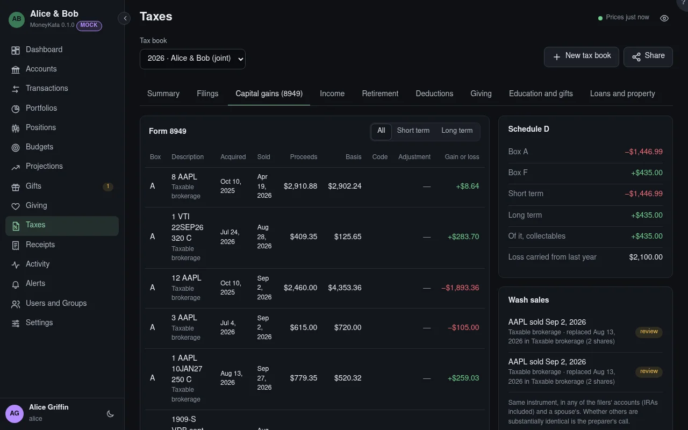

# Taxes: Capital gains (8949)

Every sale in the book's taxable accounts in the year, and each physical asset sold, as Form 8949
rows, with the Schedule D totals.

## Tax book

The book shown, for one tax year. Its panels count the book's accounts only, and say which were left
out.

## Term

All sales, or only the short- or long-term ones.

## Form 8949

Each sale: its box (A–C short term, D–F long term, by whether the broker reports the basis to the
IRS, and C or F with no 1099-B, as for crypto and items), what was sold, when it was bought and
sold, the proceeds, the basis, the adjustment code (W a wash sale, L a loss on personal-use
property, C a collectable) and amount, and the gain or loss.

## Schedule D

The totals by box, short and long term, the collectables among them (taxed at their own rate), and
last year's capital-loss carryover.

## Wash sales

A loss sale with the same instrument bought within 30 days either side, in any of the filers'
accounts (IRAs included) or a spouse's: the disallowed loss, and the replacement lot with its basis
raised by it. Whether another instrument is substantially identical is the preparer's call.
