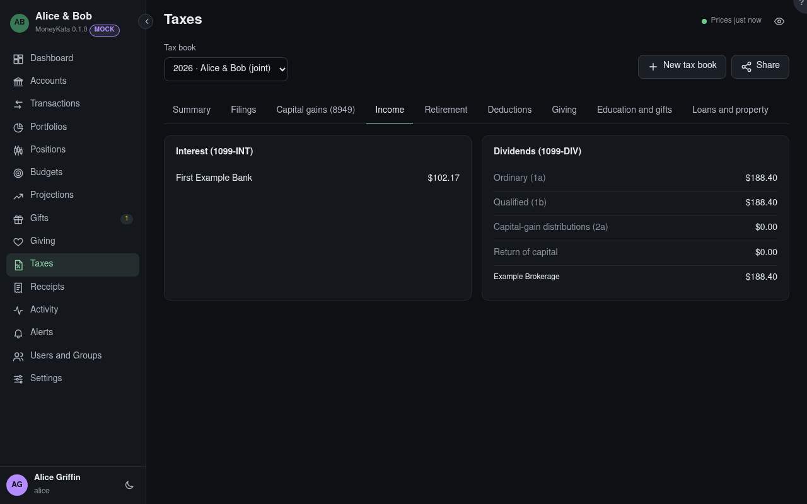

# Taxes: Income

Interest and dividends in the book's taxable accounts, as the 1099s report them.

## Tax book

The book shown, for one tax year. Its panels count the book's accounts only, and say which were left
out.

## Interest (1099-INT)

Interest by payer.

## Dividends (1099-DIV)

Ordinary dividends (qualified ones included), qualified dividends, capital-gain distributions and
returns of capital, with the totals by payer.
