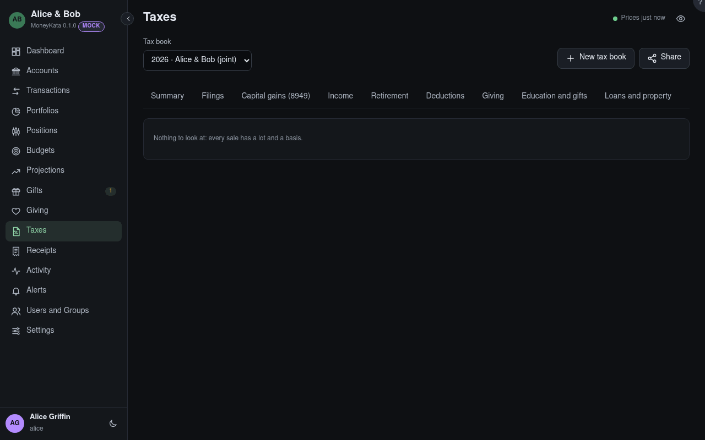

# Taxes: Issues

Missing or doubtful data to look at before the return is prepared.

## Tax book

The book shown, for one tax year. Its panels count the book's accounts only, and say which were left
out.

## Issues

Sales without a matching lot, lots and sales without a basis, shares received from another person's
account (which keep the giver's basis), and accounts left out of the book.

An edit made anyway to a year whose federal return is filed is listed first, with how far it moved
the realized gains and in which accounts. **Add an amended return** goes to Filings: adding one that
amends the federal return settles the edits, and opens the year for edits until it is filed.
**No amendment needed** settles them instead.
